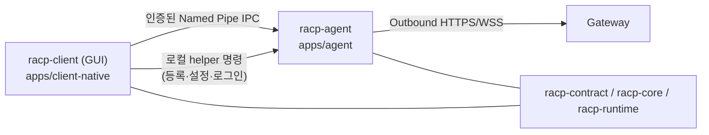

# ADR-0032: Native Client 구조와 Slint GUI

> **Document ID**: `DOC-ADR-0032`\
> **Status**: Accepted · GUI 이전 진행 전 · **Target Version**: v0.1.29\
> **Last Updated**: 2026-10-13 · **Classification**: Architecture Decision Record

---

## 개요

이 문서는 `apps/client-native` Client의 현재 결정을 하나로 모은 기록이다. 이전 Client ADR(0023~0031)은 Electron·Python·Tauri 시절의 구현 설명과 이력이 섞여 있어 삭제했다. 그중 현재도 유효한 결정만 현재 코드 기준으로 이 문서에 다시 적는다. 과거 구현과 검증 이력은 git 기록과 [구현 현황](../quality/implementation-status.md)에 남는다.

> [!IMPORTANT]
> GUI 툴킷 결정은 Iced에서 **Slint**로 바뀌었다. 현재 저장소의 `apps/client-native`와 배포 빌드는 아직 **Iced**다. Slint 이전은 [5절](#5-gui-이전-순서와-완료-조건)의 순서로 진행하며, 완료 전에는 Iced 빌드가 계속 제품 기준이다.

---

## 목차

- [1. 구조](#1-구조)
- [2. GUI 툴킷: Slint](#2-gui-툴킷-slint)
- [3. 등록·설정·상태](#3-등록설정상태)
- [4. 수명·트레이·자동 시작·설치](#4-수명트레이자동-시작설치)
- [5. GUI 이전 순서와 완료 조건](#5-gui-이전-순서와-완료-조건)
- [6. 보안 원칙](#6-보안-원칙)
- [7. 관련 문서](#7-관련-문서)

---

## 1. 구조

- Client는 Rust 단일 프로세스 GUI다. 로직은 `racp-contract`(계약), `racp-core`(DPAPI·정책·경로·상태), `racp-runtime`(로컬 IPC·Agent 실행)을 직접 사용한다.
- Agent는 Gateway로 먼저 연결한다(outbound HTTPS/WSS). PC에 inbound listener를 열거나 Gateway가 LAN을 스캔하지 않는다.
- 배포물에는 Rust GUI, Rust Agent, 필요한 정적 자산·LICENSE·SBOM만 넣는다. CPython, Node, Electron, React, WebView2는 넣지 않는다.
- Chromium·CDB·GDB·분석 host는 선택 runtime이다. 기본 payload와 별도로 manifest의 hash·size·OS·arch를 검사해 받아들이고 실행 동안 파일을 고정한다.
- OS별 코드는 `#[cfg(...)]` 어댑터 뒤에 둔다. 현재 구현 대상은 Windows x64이고, macOS/Linux는 별도 요청 전까지 빌드하지 않는다.

## 2. GUI 툴킷: Slint

### 결정

GUI는 **Slint 1.16.x**(선언형 `.slint` + Rust)로 작성한다. 기본 렌더러는 **소프트웨어 렌더러**로 고정하고, GPU 렌더러는 명시적 옵션으로만 쓴다.

### 근거

| 후보 | 판단 |
|---|---|
| Iced 0.13 (기존) | tiny-skia가 흐림 그림자를 다시 그릴 때마다 CPU로 계산해 느리다. 스타일 표현력이 부족해 디자인 기준([enterprise_gui_demo.html](../spec/enterprise_gui_demo.html))과 차이가 크다. 릴리스마다 API가 깨지고 IME·접근성은 직접 만든 계층에 의존한다 |
| Tauri 2 + TypeScript | 화면 재현과 웹 생태계는 유리하다. 그러나 WebView2 의존(번들 금지 규칙과 충돌), 상주 메모리 100~200MB, Linux WebKitGTK 품질, 승인 권한이 있는 화면의 웹 보안 면이 불리하다 |
| **Slint** | 세 OS에서 같은 렌더러를 쓴다. GPU 없이도 실사용 가능한 소프트웨어 렌더러가 있다. Rust 모델에 같은 프로세스에서 직접 바인딩하고, AccessKit 접근성·IME·`@tr()` 번역이 내장되어 있다 |

PoC(`apps/client-slint-poc`, 미병합 브랜치)를 GPU가 없는 Windows VM에서 측정했다. 증거는 `dist/verification/client/0.1.26/slint-poc-20261013-01/`에 있다.

| 항목 | 결과 |
|---|---|
| 디자인 기준과 일치 | 색·모서리·그림자·hover 전환·아이콘·글꼴이 근접. 작은 차이만 남음 |
| 소프트웨어 렌더러 | 일반 다시 그리기 0.5~8.9ms(150% DPI 포함). 최악의 전체 다시 그리기는 평균 12ms, 순간 30~68ms |
| 메모리 | 유휴 시 약 44MB, 사용 중 최대 약 49MB |
| 한글 IME | 확정과 조합 중 글자 표시 모두 정상 |
| 접근성 | 접근성 트리에서 메뉴·선택 버튼의 이름과 상태를 확인. Narrator 실행 확인과 카테고리 머리글의 Tab 이동은 남음 |

### 조건

- **Rust 1.90 고정**이므로 Slint 1.17 이상(Rust 1.92 필요)은 쓰지 않는다. 툴체인을 올릴 때 함께 검토한다.
- **렌더러를 직접 지정한다.** Slint 기본 설정은 OpenGL이 없으면 소프트웨어로 넘어가지 않고 종료한다. GPU가 있다가 사라지는 경우(RDP 연결 등)를 피하기 위해 "GPU 시도 후 자동 전환" 방식은 쓰지 않는다.
- **라이선스**: Slint Royalty-free 라이선스를 따른다. About 화면에 `AboutSlint`를 넣거나 공개 다운로드 페이지에 "Made with Slint"를 표기한다. 임베디드 기기 사용과 Slint API의 재노출은 하지 않는다.
- **글꼴**: OFL 글꼴(Pretendard, Inter, JetBrains Mono)을 포함할 때 LICENSE/SBOM에 기록한다.
- **화면과 로직 분리**: `.slint`는 표시만 담당한다. 상태와 명령은 Rust(`ui_model.rs`)가 소유한다.
- **번역**: 고정 UI 문구는 `@tr()`로 처리한다. 권한 카탈로그 이름처럼 데이터에서 오는 문구는 Rust 쪽에서 번역한다.

## 3. 등록·설정·상태

### 3.1 독립 상태

- 사용자 상태는 `%LOCALAPPDATA%\RACP\native-client`에 둔다. 포터블 실행은 `--state-dir`로 지정한 별도 경로를 쓴다.
- 이전 Electron·Tauri Client의 설정과 credential은 탐색하거나 자동으로 가져오지 않는다. 새 Client는 새 등록을 명시적으로 진행한다.
- 기존 설치·등록·Device·credential·사용자 데이터는 지우지 않는다.
- 정책과 설정 변경은 revision CAS로 처리한다. 다른 곳에서 먼저 바뀌었으면 거부하고 다시 열도록 한다.

### 3.2 연결 파일(.racp) 등록

- 새 PC 등록은 Gateway Console이 발급한 `.racp` 연결 파일로 한다. 파일에는 version, Gateway origin, 1회용 등록 token(10분), 만료 시각, 공개 CA PEM이 들어 있다.
- 파일은 크기 한도, strict schema, HTTPS origin, 만료, CA PEM(private key 거부)을 검사한다.
- GUI에는 Gateway, 만료 시각, CA hash만 표시한다. **token과 원시 JSON은 GUI로 넘기지 않고 Agent helper만 다룬다.**
- 등록할 때 파일을 다시 읽고 확인 당시 SHA-256와 같은지 검사한다. 달라졌으면 token을 쓰지 않고 다시 선택하게 한다.
- CA는 상태 폴더에 content hash 이름으로 보존한다. 원본 연결 파일은 등록 후 없어도 된다.
- 결과가 불확실한 등록(`native-registration.pending`)이 있으면 새 등록을 재시도하지 않는다.
- 이미 등록된 credential은 덮어쓰지 않는다.

### 3.3 설정 수정과 복구

- 등록 후에는 같은 편집기로 Gateway 접속점, 작업 폴더, 실행 profile, CA를 바꾼다. Device ID와 credential은 유지한다.
- 저장은 Agent lifetime lock을 얻어야 하므로 Agent 실행 중에는 거부한다. 자동 중지나 재시작은 하지 않는다.
- 저장 전 기존 보호 문서를 같은 방식으로 백업하고, 원본은 임시 파일·fsync·atomic replace로 바꾼다. 백업에 실패하면 원본을 유지한다.
- 손상되었거나 다른 사용자로 해독되지 않는 credential은 복구 편집으로 덮어쓰지 않는다.
- 저장된 설정을 읽지 못해도 새 등록 화면을 띄우지 않는다. 오류는 정해진 코드로만 표시하고 token·credential·서버 응답·경로는 오류 문구에 넣지 않는다.

## 4. 수명·트레이·자동 시작·설치

### 4.1 창과 트레이

- 창을 닫으면 트레이로 숨긴다. 관리 중인 작업은 취소하지 않는다.
- 트레이 아이콘은 연결(녹색), 진행 중(황색), 미연결(회색)으로 상태를 표시한다. 메뉴는 "RACP 열기", "Agent 종료", "Agent 정리 후 앱 종료"(서비스 모드는 "앱 종료")다.
- SID·session·상태 root별 named mutex로 단일 인스턴스를 유지한다. 다시 실행하면 기존 창을 활성화한다.
- 전체 종료는 IPC Stop을 보내고 Agent lock 해제를 확인한 뒤에만 끝낸다. 결과가 불명확하면 정리 완료로 처리하지 않는다.

### 4.2 로그인 후 자동 시작

- 기본값은 꺼짐이다. 켜면 현재 사용자 `HKCU\...\Run`에 고정된 Client 경로와 `--state-dir <root> --start-agent --require-package` 인자만 등록한다.
- token, Gateway 주소, 파일 경로는 자동 시작 인자에 넣지 않는다. 서비스나 관리자 권한은 쓰지 않는다.
- 끌 때는 자기 값만 지운다. 다른 설치를 가리키는 값은 건드리지 않는다.

### 4.3 설치와 제거

- 사용자 권한 NSIS 설치로, 기본 경로는 `%LOCALAPPDATA%\Programs\RACP-Native\<version>\payload\`다. 버전마다 별도 폴더에 설치하고, 기존 폴더가 있으면 설치를 중단한다.
- 제거 전 `racp-agent native-maintenance-status`로 자동 시작 해제와 Agent 정지를 확인한다. 확인되지 않으면 제거를 중단한다.
- 제거해도 등록 정보와 사용자 데이터는 보존한다.
- 개발 빌드는 서명하지 않는다. clean-machine 설치, 업그레이드, 서명은 별도 gate다.

## 5. GUI 이전 순서와 완료 조건

별도 계획서는 두지 않는다. 진행 결과는 [구현 현황](../quality/implementation-status.md)에만 기록한다.

| 단계 | 내용 |
|---|---|
| 1. 기반 | Slint 창, 소프트웨어 렌더러 지정, `ui_model.rs` 바인딩, IPC 구독(`slint::invoke_from_event_loop`), Win32 트레이·단일 인스턴스 연결 |
| 2. Status | 등록 폼(.racp), Agent 시작·정지, 지표 카드, 감사 로그 |
| 3. Permissions | 카테고리 트리, 3-Way 선택기, 제약 편집, revision CAS 저장 |
| 4. Approvals·Runtime·Settings | 승인 큐, 선택 runtime, 설정 편집·언어·자동 시작 |
| 5. 정리 | Iced 의존성, `accessibility.rs`, `controls.rs` 접근성 래퍼, `i18n/*.rs` 삭제. 이 문서와 AGENTS.md를 갱신 |

각 단계의 완료 조건:
- 디자인 기준과 나란히 놓은 스크린샷
- 소프트웨어 렌더러의 hover·스크롤 프레임 시간
- GPU가 없는 환경과 RDP 연결 상태에서 실행
- 한글 IME와 Narrator 확인
- `cargo clippy -D warnings` 통과

PoC에서 남은 문제(카테고리 머리글 Tab 이동, 펼친 화살표 방향)는 3단계에서 해결한다.

## 6. 보안 원칙

- GUI는 원격 RPC payload나 credential을 읽어 표시하거나 전달하지 않는다. DPAPI 키와 원시 token은 그리지 않는다.
- GUI와 Agent는 인증된 Named Pipe로만 통신한다. 서비스 모드 GUI는 로컬 helper 명령(등록·설정·로그인)을 실행하지 않는다.
- 배포물에는 enrollment token, credential, Gateway별 설정, 로컬 Device 상태를 넣지 않는다.
- 개발과 검증 중 실제 설치, 서비스 등록, 등록된 상태 변경을 하지 않는다.

## 7. 관련 문서

- [Desktop Client 가이드](../guides/desktop-client-guide.md)
- [Rust Agent 가이드](../guides/rust-agent-guide.md)
- [GUI 디자인 기준](../spec/enterprise_gui_demo.html)
- [구현 현황 SSOT](../quality/implementation-status.md)
- [ADR 목록](README.md)
