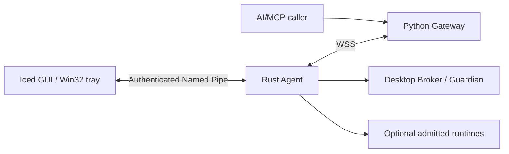

# RACP native 데스크톱 클라이언트 운용 가이드

> **Document ID**: `DOC-GDE-DESKTOP`\
> **Status**: Active · **Target Version**: v0.1.29 native development\
> **Last Updated**: 2026-10-13 · **Classification**: User & Operations Guide

## 개요

기본 Client는 Iced/Rust GUI와 Rust Agent다. Gateway·Python CLI/SDK와 React Console은 서버 측에 유지한다. 기본 Client payload는 native 실행 파일·정적 asset·license/SBOM만 포함하고 브라우저/분석 host는 선택 runtime으로 관리한다. 이전 Tauri/React Client source와 Node/WebView2 패키징 경로는 폐기했다.

> [!IMPORTANT]
> Windows 핵심 Agent/GUI 및 사용자 계정용 설치·실행·제거를 격리된 상태에서 확인했다. 전체 기능 인수·업데이트·clean-PC·서명·머신 서비스 설치는 별도다. 정확한 산출물·검사 범위는 [구현 현황](../quality/implementation-status.md)에 기록한다. 기존 설치·Device·credential·사용자 데이터는 보존한다.

## 목차

- [1. 시스템 아키텍처 및 역할 관계](#1-시스템-아키텍처-및-역할-관계)
- [2. 배포 패키지 구성 및 플랫폼 지원](#2-배포-패키지-구성-및-플랫폼-지원)
- [3. 클라이언트 실행 및 최초 등록 (.racp)](#3-클라이언트-실행-및-최초-등록-racp)
- [4. 시스템 트레이 및 백그라운드 수명주기](#4-시스템-트레이-및-백그라운드-수명주기)
- [5. 등록 정보 편집 및 안전 복구](#5-등록-정보-편집-및-안전-복구)
- [6. 개발 빌드 및 패키징 절차](#6-개발-빌드-및-패키징-절차)
- [7. 보안 및 안전 고려사항](#7-보안-및-안전-고려사항)
- [8. 관련 문서](#8-관련-문서)

## 1. 시스템 아키텍처 및 역할 관계

GUI는 로컬 Agent의 상태·권한·승인·수명주기를 관리한다. Agent가 Gateway로 아웃바운드 WSS 연결을 시작하며 AI/MCP 호출자는 Gateway를 통해 요청한다. GUI local control은 사용자/session/process identity를 확인하는 Named Pipe이며 Desktop Broker/Guardian endpoint와 분리된다.



## 2. 배포 패키지 구성 및 플랫폼 지원

| 플랫폼 | 형식 정의 | 기본 payload | 현재 증거 |
|---|---|---|---|
| Windows x64 | NSIS setup / native portable EXE / ZIP | Client·Agent·license/SBOM | 사용자용 setup 생성 및 격리된 실제 설치/GUI/제거 확인 |
| macOS x64/arm64 | DMG / APP ZIP | 해당 OS의 native executable | 정의만 제공; native build 보류 |
| Linux x64/arm64 | deb / AppImage | 해당 OS의 native executable | 정의만 제공; native build 보류 |

Native staging은 `dist/client/<version>/<target>/<build-id>/staging/`, 요청된 제품 output은 같은 batch의 `packages/`다. 독립 Agent는 `dist/agent/<version>/win-x64/<build-id>/build/`, Gateway는 `dist/gateway/<version>/win-x64/<build-id>/packages/`로 분리한다. 모든 새 개발 패키지는 unsigned다. 전체 규칙은 [AGENTS §9](../../AGENTS.md#9-build-output-layout)를 따른다.

### 2.1 Windows 설치본 사용

1. `packages/RACP-Native-<version>-win-x64-setup.exe`를 실행한다. Client GUI와 동반 Agent가 한 번에 설치된다. 관리자 권한이 필요 없는 현재 사용자용 설치다.
2. 기본 설치 폴더는 `%LOCALAPPDATA%\Programs\RACP-Native\<version>`이다. 설치 완료 화면의 **RACP 실행** 또는 시작 메뉴의 **RACP Native <version>**으로 실행한다.
3. GUI에서 연결 파일과 작업 폴더를 확인하고 권한을 설정한 뒤 등록한다. **Agent 시작**으로 Gateway에 연결한다.
4. 제거할 때는 로그인 자동 시작을 해제하고 Agent를 정지한 뒤 GUI를 종료한다. Windows **설정 → 앱 → 설치된 앱**에서 해당 RACP 버전을 제거한다. 등록 정보와 사용자 데이터는 별도 상태 폴더에 남는다.

같은 버전을 기존 폴더에 덮어쓰지 않는다. 새 버전은 별도 버전 폴더에 설치한다. 기본 설치본은 Windows 서비스 등록이나 자동 등록을 수행하지 않는다.

> [!IMPORTANT]
> `staging/racp-native-portable.exe`는 내부 파일을 합치기 전의 패키징용 실행기다. 직접 실행하지 않는다. 개발 GUI는 `staging/payload/racp-client.exe`이며 동반 파일이 필요하다. 실제 포터블은 `packages/*-portable.exe`, 설치본은 `packages/*-setup.exe`다.

## 3. 클라이언트 실행 및 최초 등록 (.racp)

새 native 상태 경로에서 연결 파일을 확인하고 표시된 Gateway·만료·파일 hash를 검토한다. 기본 작업 폴더·추가 작업 영역과 실행 프로필을 선택한 뒤 권한 탭에서 필요한 leaf/category와 승인 정책을 설정한다. 초기 선택은 모두 거부다. 등록 후 Agent 시작을 요청하고 인증 IPC snapshot/WSS 상태를 확인한다. token은 GUI view나 argv로 표시하지 않는다.

기본 user state는 `%LOCALAPPDATA%/RACP/native-client`, native 포터블은 별도 launcher 위치별 state를 사용한다. 이전 Client credential을 자동 가져오거나 v1/v2 설정을 변환하는 경로를 사용하지 않는다. 미확정 등록 marker가 있으면 자동 재등록하지 않는다.

## 4. 시스템 트레이 및 백그라운드 수명주기

상태 화면은 최근 작업 32개의 operation ID·request ID·operation·상태를 표시한다. Agent 재시작 후 Journal에서 메타데이터를 복원하며, 중단된 실행은 UNKNOWN으로 유지하고 자동 재실행하지 않는다. 현재 Agent의 진행 중인 작업에는 작업 취소 버튼이 있다. 연결이 끊기거나 Agent를 종료 중일 때는 새 취소 요청을 보내지 않는다.

취소는 인증된 로컬 사용자의 Agent 제어이며 PID 또는 임의 프로세스 경로를 받지 않는다. 표시된 boot ID·operation ID·request ID와 실제 Journal/실행을 다시 비교한다. 접수는 취소 성공을 뜻하지 않으며, 최대 15초의 관찰 뒤 취소 신호 여부·Journal 종료 상태·정리 상태를 각각 표시한다. 관찰 시간 초과 또는 미보고 정리를 성공으로 간주하지 않는다. 최근 제어 결과 16개는 같은 boot의 재연결에 사용하며, 취소 intent와 실제 operation 상태는 Journal에 기록한다. GUI/IPC 동작의 실기 인수는 보류다.

창 닫기는 tray hide다. tray에서 창 표시·Agent 종료·정리 후 전체 종료를 선택한다. GUI와 Agent는 독립 user process이며 시작 PID만으로 ready를 판정하지 않는다. 작업 상태는 요청/operation ID와 상태 metadata만 표시한다. 연결이 끊기면 마지막으로 확인한 정보임을 표시한다.

전체 종료는 Stop receipt와 실제 resource cleanup, Agent lock 해제 및 private `native-run.json`의 최종 정리 기록을 확인한다. 시작 전에 이전 성공 기록을 무효화하고, 실행별 run/boot ID를 저장한다. 등록 직후의 미시작 상태와 최종 정리 완료만 정상 종료로 인정하며, 잠금 해제만으로 강제 종료·정리 실패를 성공으로 추정하지 않는다. 기록이 없거나 시작/실행 중으로 남아 있으면 정리 미확정으로 표시한다. 명시한 앱만 종료는 Agent 정리 성공을 의미하지 않는다. Explorer 재시작 시 tray 재등록과 실제 접근성/renderer/한글 입력 인수는 별도 검증 대상이다.

Agent 실행 진입점은 native 명령과 고정 Broker/Guardian/Provider worker로 한정한다. 이전 `bridge/run/start/serve`와 loopback TCP 제어·구 credential 등록 명령은 폐기했다. 설정/등록 helper의 실패는 `error.code`로 전달하며 framed worker의 stdout에는 제어 응답을 섞지 않는다. 이 source 변경은 실제 종료·강제 종료·복구 인수를 대신하지 않는다.

## 5. 등록 정보 편집 및 안전 복구

권한·시간/출력 상한은 hot policy revision CAS로 저장한다. workspace/profile/runtime은 Agent 종료 후 저장하고 다음 시작에 적용한다. 설정 revision이 바뀌면 현재 설정을 다시 불러온다. Gateway·Device·CA와 credential은 기존 등록의 신뢰 정보이며 다른 서버 이전은 별도 새 등록이 필요하다.

로그인 시작은 현재 사용자의 고정 native Client 명령만 등록한다. 다른 앱의 항목을 덮어쓰지 않고 pending 변경은 실제 OS 값과 비교해 사용자가 결과를 다시 확인한다. 실제 등록/로그인/취소/복구 동작은 아직 실기 인수되지 않았다.

## 6. 개발 빌드 및 패키징 절차

Client는 Rust 1.90.0·Windows SDK/MSVC x64·xtask를 사용한다. Node 22.23.0/pnpm 11.19.0은 retained Console만 빌드한다. [빌드 스킬](../../.agents/skills/desktop-build/SKILL.md)과 [AGENTS](../../AGENTS.md#8-desktop-build-definition-desktop-build-skill)의 Windows/버전/보존 정책을 따른다. PATCH는 변경 배치당 한 번만 적용하고 재시도·형식마다 재증가하지 않는다.

<a id="native-development-staging"></a>

### 6.1 Native 개발 staging (Iced/Rust)

새 Client는 Rust 1.90.0·Windows SDK/MSVC x64가 필요하며 기본 payload는 Client·Agent·LICENSE·SBOM과 해당 파일의 manifest다. Node·Python·WebView2·Chromium을 실행하거나 동봉하는 빌드 경로가 아니다. 브라우저/분석 도구는 별도 runtime admission을 사용한다.

```powershell
# 정의만 출력; 쓰기/빌드/설치 없음
cargo run --locked -p xtask -- package --platform win --arch x64 --dry-run

# 고유 build-id로 production 컴파일 및 개발 staging
cargo run --locked -p xtask -- stage --platform win --arch x64 --build-id <unique-build-id>

# 생성된 payload·launcher hash, 크기 및 native target 확인
cargo run --locked -p xtask -- verify-staging --platform win --arch x64 --build-id <unique-build-id>
```

staging은 `dist/client/<version>/win-x64/<build-id>/staging/`, 실행 파일은 별도 static CRT target에서 빌드한다. 기존 batch는 덮어쓰지 않으며 실패 phase만 sibling `.quarantine`으로 보존한다. 사용자 명시적 전체 초기화 요청은 기본 산출물 보존 규칙보다 우선한다. manifest는 소스 commit/dirty 상태/파일 digest, toolchain, Cargo.lock digest, feature 및 실제 payload hash를 기록한다. SBOM은 Cargo native dependency graph를 기록하며 license 검토·시스템 DLL/외부 build tool 전체 inventory를 대신하지 않는다.

독립 Agent만 빌드하려면 `cargo run --locked -p xtask -- stage-agent --build-id <unique-build-id>` 및 `verify-agent`를 사용한다. Client GUI 없이 Agent EXE·LICENSE·Agent 전용 SBOM·hash manifest를 생성한다.

같은 `build-id`에 대해 `cargo run --locked -p xtask -- package --platform win --arch x64 --build-id <unique-build-id> --install-scope user`를 사용한다. pinned NSIS 3.11 compiler를 PATH에 두며 setup EXE·완성된 native 포터블 EXE·ZIP을 생성한다. 현재 사용자 지시는 설치 파일 생성까지만 허용하며 **실제 설치 실행은 금지**한다. 이 지시 이전의 임시 설치·제거 검사 결과는 구현 현황에 기록하며 반복하지 않는다. signing/publishing은 별도 release 절차다.

설치 recipe는 사용자별·버전별 디렉터리를 사용하며 기존 버전 폴더를 덮어쓰지 않는다. 제거는 고정 payload 파일만 다루고 state/credential은 보존한다. 실행 중인 파일은 pin으로 보호되며 실패한 제거를 성공으로 처리하지 않는다. 자동 updater·per-machine/service 설치 및 clean-PC DLL 검증은 별도 후속 작업이다.

native 포터블은 legacy footer를 허용하지 않고 매 실행에 admitted 파일을 다시 확인한다. 기본 사용자 state와 분리된 `RACP/native-portable-state/<launcher-path-hash>`에서 새 등록하며 이전 credential을 가져오지 않는다. 캐시는 전체 2 GiB와 failed candidate 4개 상한을 적용하고 실패 candidate를 자동 삭제하지 않는다. 포터블 파일명/위치가 바뀌면 별도 상태 경로가 선택된다.

macOS/Linux 형식은 `--dry-run`으로 정의를 확인하며 native build·배포를 시작하지 않는다. 실제 체크 결과는 [구현 현황](../quality/implementation-status.md)에만 기록한다.

### 6.2 Native 설정과 로그인 시작

새 등록 후 설정 탭에서 기본 작업 폴더, 최대 15개의 추가 작업 영역과 실행 프로필을 편집한다. 설정 저장은 Agent가 완전히 종료된 상태만 허용하며, revision 충돌은 다시 불러오기로 확인한다. 저장 후 Agent를 다시 시작한다. 권한·시간/출력 상한은 권한 탭에서 별도로 저장한다. Gateway·Device·CA는 등록의 신뢰 정보로 보존하고 이 화면에서 credential을 다른 대상으로 이전하지 않는다.

로그인 시작은 현재 사용자의 고정 native Client 명령 하나만 등록한다. 등록 시 검증된 packaged payload가 필요하며 실행 중인 앱은 그대로 둔다. 로그인 때 등록된 Client가 같은 native 상태 경로에서 이미 등록한 Agent를 시작한다. 상태 탭의 새 등록은 자동으로 수행하지 않는다. registry 값의 존재는 실제 로그인 실행 성공이나 Windows Startup Apps 설정의 허용을 입증하지 않는다.

다른 프로그램/수동 편집이 해당 등록값을 변경하면 소유 충돌로 보고하고 덮어쓰지 않는다. 중단된 변경은 미확정 결과 다시 확인 버튼으로 실제 등록값과 durable intent를 비교한다. 외부 변경과의 원자적 CAS는 Windows Registry가 제공하지 않으며 실제 경합/로그인/제거 인수는 보류다. 기존 사용자 로그인 항목과 legacy Client 등록은 자동 수정하지 않는다.

### 6.3 Native 선택 runtime

runtime 화면에서 전체 bundle manifest의 SHA-256을 확인해 로컬 원본 디렉터리를 admission하고, 활성화할 manifest hash를 별도로 선택한다. Agent를 완전히 종료한 상태에서 설정을 저장한다. Chromium·CDB·GDB·native 분석 host를 각각 선택할 수 있으며 비워 두면 해당 runtime을 시작하지 않는다. 기본 Client 패키지는 이 도구를 동봉하지 않는다.

CDB bundle은 `cdb.exe`와 같은 디렉터리의 `dbgeng.dll`·`dbghelp.dll`, 전체 의존 파일과 license가 필요하다. 실제 파일 버전과 manifest version을 확인한다. GDB의 entrypoint는 `gdb`/`gdb.exe`이며 고정 Rust MI adapter로 연결한다. 분석 host의 entrypoint는 `racp-analysis-host`/`racp-analysis-host.exe`이고 [native plugin 계약](../protocol/plugin-manifest-v1.schema.json)의 bounded stdio framing·manifest/backend version handshake를 구현해야 한다. `java.exe` 또는 기존 Java bridge를 분석 host로 지정하지 않는다.

시작 때 OS/arch·모든 파일 hash·size 및 실제 파일 목록을 다시 검사하고 실행 동안 pin을 유지한다. 선택한 runtime이 누락·손상되면 해당 기능을 unavailable로 남기고 파일·프로세스 등 기본 경로를 시작한다. legacy `plugins.json`/`native-runtime.json`, 기존 설치 디렉터리와 PATH의 분석 도구를 native 선택으로 가져오지 않는다. 분석 helper는 첫 authorized open에서 health handshake를 수행한다. `ADMITTED`는 실제 엔진 실행 성공을 뜻하지 않는다.

admission은 명시한 로컬 hash 동의이며 제품 서명/공식 trust catalog 또는 공급망 검토를 대신하지 않는다. packet-driver activation, 실제 MCP/덤프/PCAP/debugger 인수, 다운로드·서명 trust catalog는 후속 상태다. 현재 문서의 절차를 구현한 것과 실제 도구를 등록/실행해 검증한 것을 구분한다.

### 6.4 별도 native 분석 host 빌드

선택 host source는 `apps/analysis-host/`의 독립 Cargo workspace다. 기본 Client/Agent workspace와 payload에 포함하지 않는다. 프로젝트 Java bridge와 Ghidra 실행 코드는 이 host에만 있으며 Agent의 `plugin-ghidra/provision-ghidra` 경로는 제거했다. Agent는 고정 native stdio host protocol로 분석 요청을 전달한다.

```powershell
cargo check --manifest-path apps/analysis-host/Cargo.toml --locked --target x86_64-pc-windows-msvc
$env:CARGO_TARGET_DIR = Join-Path (Get-Location) 'target/native-product'
$env:RUSTFLAGS = '-C target-feature=+crt-static'
cargo build --manifest-path apps/analysis-host/Cargo.toml --locked --release --target x86_64-pc-windows-msvc
```

compile만으로 JVM/Ghidra가 필요하거나 실행되지 않는다. 사용 시에는 host executable·일치하는 OS/arch의 engine/JDK 파일·license와 [host-runtime.json 계약](../protocol/analysis-host-runtime-v1.schema.json)을 같은 별도 admitted runtime bundle에 명시해야 한다. `host-runtime.json`에는 `schema_version: 1`, bundle-relative `installation`과 `java` 경로를 넣는다. bundle의 vendor runtime version은 Ghidra engine version이고 host app version은 repository SSOT를 따른다. 실제 bundle 조립·라이선스 검토·host admission·Java/Ghidra 실행 인수는 보류한다.

host는 자신의 admitted bundle 전체를 다시 pin하고 hash·파일 목록을 확인한다. Agent가 복사한 전용 analysis resource만 분석하며 사용자 원본에 직접 데이터베이스를 쓰지 않는다. DB import/수정 후 오류는 `unknown`으로 보고한다. vendor JVM은 host의 소유 child Job과 private 분석 디렉터리에서 실행하며 개인 Java/Ghidra 설정을 가져오지 않는다. 취소 중단은 Agent supervisor의 소유 process tree 종료 절차를 통해 회수한다.

---

### 6.5 Native 서비스 경계 (source 구현, provisioning 미완료)

별도 SCM host 이름은 `RACPNativeAgent`, 실행 계정은 그 서비스의 `NT SERVICE\RACPNativeAgent` virtual account다. 기존 `RACPAgent` 서비스·설정·등록을 가져오거나 변경하지 않는다. `native-service --state-dir <explicit-private-root>` source는 service identity와 packaged payload를 확인한 뒤 새 native 상태만 읽는다. [서비스 config 계약](../protocol/native-service-config-v1.schema.json)의 `native-service.json`은 credential과 함께 private root에만 둔다.

공유 제어 metadata는 겹치지 않는 별도 디렉터리에 둔다. service/SYSTEM만 쓰고 지정 사용자 SID만 읽을 수 있는 보호 ACL을 검사하며 credential은 공유 디렉터리에 저장하지 않는다. Named Pipe는 명시한 사용자 SID·0이 아닌 세션 ID를 확인하고 observer는 snapshot/subscribe만 허용한다. controller만 정책·승인·취소·Stop을 요청한다. 관찰자 연결은 승인자의 presence로 계산하지 않는다. 서비스 프로세스와 token에 사용자별 최소 조회 권한을 부여해 server SID·session·PID birth를 확인하며 token duplicate/impersonation 또는 process 수정 권한은 부여하지 않는다.

> [!IMPORTANT]
> 아직 서비스 설치/provisioning·관리자 config 전달 도구·native 사용자 세션 Broker 연결·per-machine packaging은 구현 중이다. GUI service endpoint 선택·초기 등록 bootstrap·config CAS/reconcile source는 연결했지만 실제 SCM/ACL/DPAPI/peer 경합 인수는 실행하지 않았다. 이 source 경계를 실제 서비스 운용 또는 전체 service 기능 완료로 사용하지 않는다. native service는 이전 service-login.json을 읽지 않고 session-0 desktop을 미구성으로 보고한다.

DPAPI는 서비스 계정의 기본 user scope를 유지한다. 해당 계정의 DPAPI/profile이 사용 불가능하면 실패하며 machine scope 또는 plaintext로 전환하지 않는다. [Microsoft DPAPI 설명](https://learn.microsoft.com/en-us/windows/win32/SecCrypto/example-c-program-using-cryptprotectdata)과 [service SID 설명](https://learn.microsoft.com/en-us/windows/win32/api/winsvc/ns-winsvc-service_sid_info)을 기반으로 설계했으며 실제 계정/profile 검증은 남아 있다. pipe client의 write 권한에서 create-instance bit를 제외하는 설계는 [Named Pipe 보안 설명](https://learn.microsoft.com/en-us/windows/win32/ipc/named-pipe-security-and-access-rights)을 따른다.

### 6.6 Service GUI와 bootstrap source 연결

packaged native GUI의 `--service-control <shared-control-dir>`는 하나의 explicit service target을 선택한다. `--state-dir`/`--portable-state`/`--start-agent`와 함께 사용할 수 없다. service 모드의 singleton/tray/IPC는 이 제어 경로를 사용하고 현재 사용자 state/credential·등록·로그인·runtime helper를 읽거나 실행하지 않는다. 서비스에서 받은 role과 Device/Gateway origin을 표시하며 observer는 정책 조회만, controller는 승인·정책·취소·명시 Stop을 요청한다. 앱 종료는 서비스 Stop과 분리한다. 연결 중단·gap/boot 변경 이후에는 role을 다시 확인한다.

최초 service 등록 source는 SCM의 `native-service --state-dir <private-root> --bootstrap-sha256 <hash>`에서 선택한다. private root에는 고정 `native-service.json`, `native-service-bootstrap.json`, `native-service-connection.racp`만 전달하며 bootstrap은 native enrollment의 connection path/hash·workspace/profile·초기 policy 형식이다. credential이나 enrollment token을 command line 또는 GUI IPC로 보내지 않는다. 역할 config·private ACL·고정 service account를 확인하고 bootstrap hash와 고정 connection 파일/hash를 다시 검사한 뒤, DPAPI roundtrip을 확인하고 one-use token을 소비한다.

등록 취소/timeout/비확정 결과는 durable native-registration.pending으로 재등록을 막는다. 성공한 등록의 input cleanup은 device/hash/file revision을 별도 durable marker에 기록하고 동일 입력만 handle로 삭제한다. 재시작 때 cleanup marker를 확인하며 외부 변경은 conflict로 남긴다. 이미 등록한 native state는 bootstrap을 다시 소비하지 않는다. DPAPI probe는 enrollment credential/application file을 쓰지 않지만 Windows가 profile/key material을 초기화할 수 있으므로 실제 profile/취소/복구 인수는 별도다.

> [!IMPORTANT]
> 위 flags와 입력 pipeline은 source·production 컴파일 checkpoint다. provisioning/config 전달 source는 §6.7–6.8에 연결했지만 SYSTEM installer runner와 제품 artifact는 미완료이므로 실제 수동 service 설치/등록 절차로 실행하지 않는다. GUI·bootstrap·입력 정리·재시작의 실제 동작은 인수하지 않았다. service snapshot의 desktop/clipboard는 사용자 화면 연결 전 `NATIVE_SERVICE_SESSION_NOT_CONNECTED`로 표시하며 §6.9의 인증 연결 후에도 실기 인수 전에는 `Unverified`다.

### 6.7 Stopped-service config CAS/reconcile source

등록된 서비스가 완전히 정지한 상태에서만 private `native-service-update.json`의 [update 계약](../protocol/native-service-update-v1.schema.json)을 처리한다. 현재 revision과 config 파일의 정확한 SHA-256, 다음 revision=현재+1을 비교하고 private/control root와 service SID 이동은 거부한다. 사용자 SID·세션 목록·observer/controller 역할만 변경한다. 변경 작업과 Agent 시작은 같은 config lock을 사용하며 Agent lock도 확인한다.

SYSTEM helper는 private root identity에 묶인 일회성 start intent를 저장하고 SCM `StartService`에 `--admin-intent <UUID>`만 전달한다. 기존 `--configure-sha256`/`--reconcile-config` start arguments는 거부한다. 등록된 ImagePath/credential을 변경하거나 command line에 토큰을 넣지 않는다. service actor는 효과 전에 claim을 저장하며 이 maintenance 실행은 config 작업만 수행하고 정지한다. Agent/WSS는 시작하지 않는다. [Microsoft ServiceMain argument 설명](https://learn.microsoft.com/en-us/windows/win32/api/winsvc/nc-winsvc-lpservice_main_functionw)의 서비스명 다음 argument 규칙을 사용한다. completed receipt hash·STOPPED/PID 0/exit 0 확인 뒤 helper가 acknowledge하며, claimed/failed 또는 receipt 불일치는 정상 시작을 차단한다. 실제 SYSTEM/SCM 실행 인수는 후속이다.

`native-service-admin`의 `inspect_start_intent`, `abort_start_intent`, `acknowledge_start_intent`와 완료 maintenance의 명시 CAS 재개 규칙은 [Agent 계획 AS09](../spec/agent-service-implementation-and-test-plan.md)에 정의한다. 아직 설치된 stopped service가 없는 prepared restore 복구, queued restart 중지와 boot admission은 미완료이며 운영 절차로 실행하지 않는다.

변경 전 old/new config와 입력 hash를 durable pending intent에 저장한다. public directory 및 endpoint/lock 파일은 service owner와 고정 inherited read ACL을 확인하고, 이전/목표 ACL로 확인된 항목만 변경하거나 reconcile한다. 알려지지 않은 SID·쓰기 권한·protected child ACL·추가 파일은 conflict로 남긴다. 실행 중인 IPC lock의 보안 조회는 기존 writer를 허용하는 read handle로 수행한다. config commit과 ACL readback 후 결과 receipt를 쓰고 pending을 제거한다. 일반 Agent 시작은 pending을 거부하므로 불확실한 변경을 자동 성공으로 처리하지 않는다.

> [!IMPORTANT]
> Windows의 config 파일 replacement와 ACL 변경 사이에 외부 SYSTEM writer까지 포함한 원자적 CAS는 제공하지 않는다. native helper의 cooperative locks·직전 hash 비교·readback·durable intent로 경합을 제한하며 실제 외부 writer 경합/부분 ACL propagation/중단 복구 검증은 보류다. 이 source 절차만으로 서비스 운용 또는 설치/업데이트 인수 성공을 선언하지 않는다.

### 6.8 Fresh native service provisioning source

`native-service-provision --state-dir <fixed-state-root>`는 SYSTEM installer context에서만 사용할 수 있는 source 경로다. bounded stdin JSON은 `controllers`와 native `enrollment` 객체만 받는다. 일반 관리자에서 SYSTEM으로 전달하는 새 경로는 §6.10에 정의한다. 기존 서비스/디렉터리를 채택·덮어쓰기·중지·삭제하지 않는다.

경로는 환경 변수 대신 OS Known Folder의 ProgramData에서 `RACP-Native-Service/state`와 `RACP-Native-Service/control`로 고정한다. 실제 packaged Agent의 hash/architecture와 이미지·파일·각 부모의 trusted owner/ACL을 확인한다. SYSTEM/Administrators/OS 조회 TrustedInstaller 외에 ancestor delete/reparse/DACL 변경 또는 leaf-file 쓰기 권한이 있으면 거부한다. 보통 사용자의 staging 경로를 privileged service image로 사용하지 않는다.

입력/연결 파일 hash·만료·workspace/profile/policy·controller SID/session/role을 검증한 뒤 새 SYSTEM-owned parent와 non-secret progress receipt를 만든다. fixed RACPNativeAgent/NT SERVICE 계정을 disabled로 생성하고 unrestricted service SID를 설정한다. SeRestorePrivilege는 새 directory의 explicit owner 지정 동안만 사용하며 원래 상태로 복원한다. private root는 service/SYSTEM full access, control root는 해당 service/SYSTEM과 명시한 사용자 read/execute만 허용한다. parent도 SYSTEM 쓰기와 service/사용자 read/execute를 readback으로 확인한다.

고정 private config·bootstrap·connection 파일의 저장/readback이 끝난 후 demand-start로 전환하고 SCM account/type/ImagePath/SID-type/STOPPED/PID=0을 다시 확인한다. provision command는 StartService·enrollment·DPAPI probe·WSS·Broker를 실행하지 않는다. 결과의 prepared와 registered/ready를 구분한다. 중단된 새 namespace와 disabled/demand service는 progress receipt와 함께 보존하고 자동 adoption/rollback하지 않는다. 초기 등록은 기존 native-service bootstrap source를 통해 별도로 수행한다.

> [!IMPORTANT]
> SYSTEM runner source는 §6.10에 연결했으나 per-machine artifact·서비스 시작·실제 virtual account/profile/DPAPI·ACL·workspace access·부분 provisioning 복구 및 native session Broker 인수는 미완료다. source 연결을 실제 설치 절차 또는 서비스 기능 완료로 사용하지 않는다. 사용자 staging·기존 서비스/Device/credential을 변경하지 않았다.

Win32 정의는 [CreateServiceW](https://learn.microsoft.com/en-us/windows/win32/api/winsvc/nf-winsvc-createservicew)의 virtual-account/null-password 및 start-type 규칙과 [SHGetKnownFolderPath](https://learn.microsoft.com/en-us/windows/win32/api/shlobj_core/nf-shlobj_core-shgetknownfolderpath)를 참고했다. 실제 실행 증거는 [구현 현황](../quality/implementation-status.md)에 별도로 기록한다.

### 6.9 Service의 현재 사용자 화면 연결 (source 구현, 실기 보류)

서비스 제어 GUI의 상태 탭에서 **현재 사용자 화면 연결/해제**를 명시적으로 요청한다. 실제 인증된 controller 사용자 SID·로그인 session만 준비/등록/해제를 요청할 수 있다. observer는 연결할 수 없다. 사용자 GUI와 서비스는 같은 admitted payload의 고정 Agent 실행 경로를 비교하고 Broker/Guardian의 PID·생성 시간·SID·session·실행 파일을 OS에서 확인한다. Guardian은 모든 Job 밖에 있어야 하며 서비스는 등록 전 Broker의 HMAC 인증 상태 조회를 완료한다.

서비스는 `control/desktop-sessions/<pair-id>`에 별도 pairing bucket을 만들고 비공개 state/credential 경로를 공유하지 않는다. container는 서비스/SYSTEM write 및 지정 사용자 read이며 bucket은 서비스/SYSTEM full access와 해당 사용자 read/write/execute/delete만 허용한다. 사용자는 bucket DACL/owner 변경 권한을 받지 않는다. pair secret은 ephemeral IPC 인증값이며 서비스 enrollment credential이 아니다. 사용자별 pair file은 해당 사용자의 DPAPI로 저장한다.

해제 요청은 서비스를 통해 Broker를 종료한 뒤 사용자 GUI가 소유한 Broker Job과 Guardian 종료를 확인한다. Guardian은 서비스와 launcher의 PID/birth를 pin하고 launcher 비정상 종료·pair 삭제·stop 신호에 입력 해제를 수행한다. GUI 종료도 자체 화면 연결 정리를 기다리며 서비스 Stop과 구분한다. 실패/미확정 정리, 알려지지 않은 bucket 내용은 성공으로 보고하지 않는다. standalone `racp-agent native-service-session --service-control <absolute-control-path>`는 같은 source 연결을 사용하며 자동 로그인 등록을 만들지 않는다.

> [!IMPORTANT]
> GUI/IPC/서비스/입력은 실제 실행하지 않았다. cross-account ACL·DPAPI·세션 잠금·외부 Job의 breakaway 제한·입력 해제·서비스 중단/재시작은 실기 인수 대상이다. 만료된 빈 준비 bucket은 정리하지만 launch 진행 중이거나 실패한 bucket은 stop 신호 후 미확정 오류와 함께 보존할 수 있다. §6.10의 복구는 확인 가능한 잔여 상태만 처리하며 기존 state/credential 또는 구 service-login/Task Scheduler fallback을 사용하지 않는다.

### 6.10 관리자 SYSTEM handoff와 세션 복구 (source 구현, 실행 보류)

`native-machine-setup --state-dir <fixed-state-root>`는 elevated administrator와 machine-trusted packaged image를 요구한다. bounded stdin은 §6.8의 fresh `controllers`/`enrollment` 또는 기존 service-admin의 `type: configure/reconcile/recover_sessions` 입력만 받는다. 고정 `RACPNativeSetup` LocalSystem demand-start helper와 ProgramData의 `RACP-Native-Setup/setup_<nonce>`를 새로 만들도록 연결했다. 기존 helper는 채택하거나 교체하지 않는다. request는 Administrators/SYSTEM만 읽고 쓸 수 있도록 owner/정확한 DACL을 readback하고 file pin·SHA-256으로 연결한다. argv에는 입력 원문이나 token을 넣지 않는다.

helper는 고정 `RACPNativeAgent`를 준비하거나 stopped-service의 config/session maintenance만 실행한다. Agent의 정상 run·등록·WSS·Desktop을 시작하지 않는다. nonce/hash가 일치하는 완료 receipt와 helper STOPPED/PID=0을 확인한 경우에만 새 helper service 및 request file을 정리하고 비밀이 없는 결과를 보존한다. 120초 timeout·오류·부분 준비는 서비스와 입력/receipt를 남겨 미확정으로 보고하며 자동 재시도/rollback하지 않는다. config 완료 뒤 SYSTEM이 고정 data parent의 owner/trust를 확인하고 변경된 controller read ACL을 갱신한다.

서비스는 공개 pairing bucket과 별도로 private `desktop-session-records`에 pair ID·bucket volume/file identity·Agent/launcher/Broker/Guardian PID와 birth·정리 확인을 저장한다. `recover_sessions`는 정지한 Agent/config lock을 잡고 원래 Agent가 종료됐는지 확인한다. PID 재사용은 새 프로세스에 대한 신호로 사용하지 않으며 access denied/wait 실패를 종료 증거로 취급하지 않는다. 등록된 peer 종료·Guardian 정리 상태·bucket identity를 확인한 뒤 고정 pairing 파일만 정리한다. 전체 60초/peer wait 5초 budget과 service stop 취소를 적용한다. nonce/config hash가 같은 새 복구 receipt만 완료로 인정한다.

> [!IMPORTANT]
> 이 절차는 source 명세이며 실행하지 않았다. 기록되지 않은 bucket, 등록되지 않은 in-flight launch, 확인되지 않는 입력 정리, 바뀐 directory/receipt, 실패한 SYSTEM helper는 보존한다. 이러한 상태의 파괴적인 강제 정리/기존 service adoption은 제공하지 않는다. per-machine installer/제거·신뢰 서명·부분 provisioning 복구와 네이티브 인수는 계속 남아 있다.

### 6.11 Windows 공용 서비스 설치·제거 정의 (source, 실행 보류)

Client는 `xtask package --platform win --arch x64 --install-scope user --dry-run`만 지원한다. Agent 서비스는 `stage-agent-service` / `verify-agent-service`로 별도 payload를 만들며, `package-agent-service --dry-run`에서 GUI 없는 machine setup 정의를 확인한다. 서비스 setup 생성은 명시 요청 후에만 같은 검증 batch에서 수행하고 실제 installer 실행·서비스 등록·설치는 금지 유지다. [Agent 가이드](rust-agent-guide.md#5-생산-빌드와-보류된-검증)를 따른다.

machine recipe는 Windows x64와 관리자 권한을 요구하고 고정 ProgramFiles/RACP-Native/version에 새 payload를 배치한다. 기존 version directory는 덮어쓰지 않는다. `native-machine-install-protect`가 manifest 전체 파일을 pin하고 fixed path/content를 확인한 뒤 Administrators owner·Administrators/SYSTEM write·Authenticated Users read/execute로 보호/readback한다. 별도 machine-install receipt에 version/scope/payload manifest 및 uninstaller hash를 기록한다. Agent-only service payload는 명시 `native-agent-service` 역할·3개 파일·machine receipt의 `payload_kind`를 검사한다. Client EXE나 shortcut을 만들지 않으며 관리는 `native-service-control`의 인증 IPC를 사용한다. 사용자별 로그인 시작은 user setup/portable scope를 사용한다.

install recipe는 Gateway 입력·token·등록·서비스 시작을 포함하지 않는다. 관리자 handoff는 §6.10의 별도 bounded 입력으로 수행한다. 설치 직후 서비스가 준비되지 않았으면 GUI는 관리자 등록/시작이 필요하다는 연결 대기 상태를 표시한다.

제거 전에는 controller가 Agent 정리를 요청하고 GUI를 종료한다. `native-machine-setup`의 remove_service 입력은 `expected_config_sha256`와 `expected_device_id`(미등록 준비 상태는 null)를 요구한다. SYSTEM은 같은 fixed SCM image/account/root와 STOPPED/PID=0을 확인한 뒤 virtual-account maintenance를 수행한다. maintenance는 새 nonce/config hash·NativeRun 최종 정리·정책/runtime/Journal 형식·pending/잔여 session을 확인하며 credential을 열지 않는다. 확인 후 SCM 등록만 삭제 요청하고 Device·state/credential·workspace 및 Gateway 등록은 보존한다. 실행 중 서비스의 강제 stop/kill을 제공하지 않는다.

`native-machine-uninstall-preflight`는 두 native SCM 이름의 부재·trusted payload/설치 receipt/uninstaller hash를 확인한다. 성공 후 installer는 payload 전체 rename 뒤 고정 파일만 제거하며 Agent/관리 클라이언트/helper의 기존 directory/file pin은 rename을 차단한다. unknown removing batch·손상 receipt·외부 변경은 자동 채택/복구하지 않는다. 검사와 rename 사이 외부 관리자/SYSTEM writer까지 포함한 원자적 lease는 보장하지 않는다.

실패한 setup helper는 `native-machine-setup-cleanup`에 정확한 setup_root/input_sha256를 전달해 명시적으로 정리하도록 연결했다. high-integrity administrator·trusted package·private request의 hash/ACL·LocalSystem/own-process/demand-start/exact ImagePath·STOPPED/PID=0을 확인한다. helper SCM/request만 정리하고 비밀 없는 cleanup/result 기록 및 target 서비스/state를 보존한다. running/foreign helper나 바뀐 input을 중지·채택·삭제하지 않는다.

> [!IMPORTANT]
> Rust 컴파일과 packaging dry-run은 실제 NSIS compilation·설치/제거·ACL inheritance·SCM/profile·다중 사용자/경합 인수 증거가 아니다. 보존된 native 서비스의 명시 복원은 §6.12에 source로 연결했으며 부분 target provisioning 복구, updater 및 publisher trust는 미완료다. 기존 사용자 자료를 자동 삭제하거나 legacy 설정을 import하지 않는다.

### 6.12 보존된 native 서비스 복원과 저장 버전 (source, 실행 보류)

`native-machine-setup`의 restore_service 입력은 type·expected_config_sha256·expected_device_id·expected_bootstrap_sha256 네 필드로 한정한다. 등록된 native state는 같은 Device ID와 null bootstrap hash를 요구한다. 미등록 준비 상태는 null Device ID와 보존된 bootstrap hash를 요구한다. 기존 native SCM 등록이 있으면 채택/덮어쓰기하지 않는다.

SYSTEM은 고정 ProgramData namespace·보관 config hash/형식·private owner/DACL·state identity와 machine-trusted 새 payload를 확인한다. 삭제된 service SID의 OS lookup에 의존하기 전에 봉인된 config의 canonical SID와 private ACL을 비교하고, fixed virtual-account SCM을 disabled로 재생성한 뒤 실제 OS SID와 다시 비교한다. 별도 virtual-account maintenance가 cleanup/schema/session/identity를 검증한 경우에만 stopped demand-start 정의를 복원한다. 정상 Agent run·등록·WSS를 시작하거나 credential을 복호화/이전하지 않는다. 검증 불명 상태는 기록/새 service를 보존하고 정지 상태에서 disabled로 제한한다.

`native-release.json`은 현재 numeric SemVer와 state/policy/Journal format을 기록하는 별도 저장 버전 watermark다. 새 등록/Agent 시작 및 확인된 등록 상태의 service restore에 기록한다. 이 표시가 있는 root는 더 낮은 package version 또는 다른 저장 format으로 열지 않는다. watermark가 없던 초기 native root는 현재 형식을 확인한 첫 실행에서 현재 버전을 기록하며 구 설정을 변환하지 않는다. 표시를 무시하는 과거 binary의 동작까지 보증하지 않으며 자동 downgrade/rollback을 제공하지 않는다.

GUI는 Iced가 처리하지 않은 Tab/Shift+Tab에 focusable 입력 필드 이동을 연결하고 Ctrl+1/2/3/4/5에 상태/권한/승인/설정/runtime 페이지 이동을 연결한다. service scope의 설정/runtime 이동은 차단한다. 이는 keyboard source 연결이며 button/checkbox 전체 키보드 조작이나 Narrator/UIA·IME/DPI 인수 완료가 아니다.

> [!IMPORTANT]
> 실제 서비스 복원·DPAPI profile 유지·새/이전 native 버전 호환·GUI 키보드 동작은 실행하지 않았다. 복원 preflight나 형식/정리 확인이 실패한 상태를 정상 Agent 시작 성공으로 바꾸지 않는다. partial provisioning 복구·검증된 updater/rollback·publisher trust와 접근성 연동은 계속 남아 있다.

### 6.13 GUI 키보드와 Windows 접근성 연결 (source, 실기 보류)

현재 native GUI는 버튼·체크박스·입력 필드·여러 줄 제약 편집기·실행 프로필 선택과 표시 텍스트를 Windows AccessKit/UI Automation tree로 연결한다. 창 소유 스레드에서 숨겨진 창에 adapter를 붙인 뒤 표시하며, 초기 트레이 표시 요청은 이 순서를 앞지르지 않는다. 같은 컨트롤의 접근성 ID는 화면 갱신 사이에 유지하고 사라진 컨트롤의 ID를 다른 대상으로 재사용하지 않는다.

Tab/Shift+Tab은 활성 컨트롤 사이를 이동하며 화면 밖의 focused 컨트롤은 해당 페이지로 스크롤한다. 버튼·체크박스는 Enter/Space를 놓을 때 한 번 동작한다. 대상 교체·focus 해제·창 focus 상실은 대기 동작을 취소한다. 실행 프로필은 방향키/Home/End로 선택한다. 반복 권한/승인 버튼의 접근성 이름에 대상 권한 또는 요청 식별자를 포함한다.

입력값 변경 및 버튼 동작은 기존 GUI 메시지 경로를 사용하며 service 역할·초안·policy 저장·요청별 승인 검사를 거친다. 접근성 요청의 변경 동작은 화면 revision이 바뀌면 거부한다. window DPI와 페이지 scroll translation을 반영한 논리 좌표를 접근성 tree에 제공한다. 전체화면 캡처·Agent의 OS UIA Provider와 GUI 자체의 UIA tree는 별도 경로다.

> [!IMPORTANT]
> 이 절은 source 연결이며 Narrator·키보드·DPI·GPU 없는 VM 실행 합격을 뜻하지 않는다. pinned Iced 0.13의 Windows IME event/조합 표시 경로는 별도 보강이 필요하며 한글 조합을 구현 완료로 판정하지 않는다. 실제 GUI를 실행하지 않았고 native 제품 적합성 gate는 보류다.

## 7. 보안 및 안전 고려사항

### 7.1 Native 수동 교체와 제거 (source 정의, 실기 보류)

새 Rust 버전은 기존 version directory를 덮어쓰지 않고 별도 디렉터리에 설치한다. 현재 구현은 자동 다운로드/updater를 제공하지 않으며 아래는 source에 연결한 수동 절차다. 제품 artifact 생성·설치/교체/제거·서명 인수는 테스트 재개와 제품 패키징 요청 이후에 수행한다.

1. 새 installer/payload의 version·Windows x64·manifest·전체 파일 SHA-256을 신뢰한 배포 기록과 비교한다. 개발 staging은 서명되지 않았으므로 hash만 있는 임의 다운로드를 신뢰한 publisher로 취급하지 않는다. 기존 출력과 로컬 복구 수단을 보존한다.
2. 기존 GUI에서 로그인 시작을 해제하고 pending이 없음을 확인한다. Agent Stop의 접수와 실제 자원 정리 완료를 구분하고 전체 종료한다. 원격 요청 또는 무조건적인 process kill로 이 단계를 대신하지 않는다.
3. 기존 payload의 `native-maintenance-status --state-dir <native-root>`로 최종 정리 기록/Agent lock·state/policy/runtime·Journal 형식·로그인 변경 상태를 검사한다. 이 command는 packaged user mode 전용이며 credential을 읽거나 등록/Stop/Registry 삭제를 수행하지 않는다. 현재 사용자의 custom state를 포함한 모든 native 로그인 값을 조회해 제거할 payload 참조를 거부한다. 결과는 preflight snapshot이며 외부 SYSTEM/Registry writer까지 차단하는 atomic lease가 아니다.
4. 새 버전의 별도 설치 폴더에서 같은 explicit native root를 선택해 시작한다. 지원하지 않는 schema 또는 불완전한 Journal을 자동 변환하지 않는다. GUI의 인증 snapshot·Device/Gateway identity·실제 ONLINE/기능/정리 결과를 확인한 뒤 새 버전의 고정 로그인 명령을 명시적으로 등록한다. 실패 시 기존 설치나 state를 자동 되돌리거나 legacy Client를 실행하지 않고 진단 가능한 정지 상태로 둔다.
5. 새 경로의 health/정리가 확인된 이후 기존 버전의 제거를 요청한다. user uninstaller는 기본 native root preflight를 실행하고 GUI/Agent/helper pin이 해제된 payload 디렉터리를 `payload.removing`으로 먼저 이동한 뒤 고정 5개 파일만 삭제한다. rename 실패 시 원래 payload에 부분 삭제를 시작하지 않는다. 이동 후 삭제가 중단된 `payload.removing` batch는 자동 복구/덮어쓰기하지 않고 현지 검사 대상으로 남긴다. state/credential·선택 runtime·기존 Device는 보존한다.

Journal format 1은 현재 전체 SQL schema/constraint/index 정의가 일치하는 저장소만 연다. 빈 새 DB의 전체 schema와 user_version은 하나의 transaction으로 commit한다. 기존 테이블이 있는 version 0, 누락/추가/변경된 schema, 높은 version은 거부하며 ALTER/backfill로 고치지 않는다. 같은 Rust 형식의 호환성 확인과 실제 upgrade/rollback crash 인수는 별도이며 자동 downgrade/rollback은 제공하지 않는다.

> [!IMPORTANT]
> 이 절차는 수동 업데이트/제거 source 연결이며 실제 installer 성공을 뜻하지 않는다. publisher signing/trust catalog·자동 updater·per-machine/service 유지보수는 미완료다. custom root의 미확정 상태와 손상·경합·부분 삭제 복구는 별도 인수 대상이다.

- **자격 증명 보호**: Windows의 DPAPI(Data Protection API)를 통해 현재 로그인한 사용자 계정 영역에 자격 증명을 암호화 보존합니다. 다른 사용자 계정이나 PC로 복사 시 복호화되지 않습니다.
- **활동 감사 분리**: 데스크톱 UI의 '최근 활동' 스트림은 원격 명령 식별자 및 실행 결과 상태만을 표기하며, 명령어 인자, 원시 파일 데이터, 비밀 토큰 등 민감 정보는 화면에 노출하지 않습니다.
- **사용자 우선권 (Input Interruption)**: 원격 화면/입력 제어 중 사용자가 로컬 마우스/키보드를 조작하면 원격 제어가 즉시 일시 정지됩니다.

---

## 8. 관련 문서

- [PC 등록 및 온보딩 가이드](pc-connect-guide.md)
- [다중 작업 폴더 격리 가이드](named-workspaces-guide.md)
- [2-PC 실증 랩 가이드](two-pc-lab-guide.md)
- [아키텍처 결정 레코드: ADR-0032 (Native Client 구조와 Slint GUI)](../adr/ADR-0032-native-client.md)
