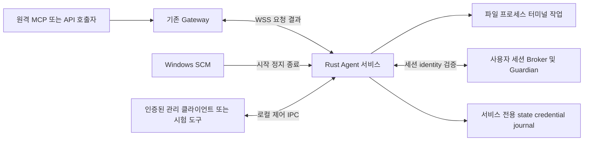

# Rust Agent 서비스 구현 및 검증 작업 계획

> **Document ID**: `DOC-PLAN-AGENT-SERVICE`\
> **Status**: Active · **Target Version**: v0.1.26 기준 / Agent 서비스 릴리스 버전 미정\
> **Last Updated**: 2026-10-12 · **Classification**: Service Implementation & Test Plan

## 개요

GUI `apps/client-native`의 재구성은 이 계획에서 제외한다. 대상은 **Rust Agent 자체의 Windows 서비스화와 원격 실행의 신뢰성**이다. 호출자→Gateway→WSS→Agent→실제 작업→결과 반환을 중심으로, 서비스 수명주기·권한·등록·취소·복구·배포 경계의 미완성 작업과 시험을 정리한다.

Agent 서비스의 현재 후속 작업은 이 문서가 SSOT다. [Rust 전환 계획](rust-client-migration-plan.md)은 공통 설계 기준, [기존 Client·Agent 통합 계획](native-client-completion-and-test-plan.md)은 이전 범위의 참조로 유지한다. 실제 실행 결과·실패·artifact hash는 [구현 현황](../quality/implementation-status.md)에만 기록한다.

> [!IMPORTANT]
> 이번 요청은 **계획서 작성**이다. 코드 구현·빌드·테스트·설치·서비스 등록/시작/정지·기존 서비스 변경을 수행하지 않는다. 사용자의 **실제 설치 금지** 지시는 유지된다. 문서에 서비스 시험을 기재한 것이 실행 허가는 아니며, 실제 SCM 인수는 별도 요청과 전용 테스트 환경이 필요하다.

## 목차

- [1. 포함 범위와 제외 범위](#section-01)
- [2. 현재 구현 상태와 구체적 공백](#section-02)
- [3. 목표 서비스 구조와 계약](#section-03)
- [4. 미구현·보완 작업 및 우선순위](#section-04)
- [5. 테스트 계획](#section-05)
- [6. 작업 순서와 종료 기준](#section-06)
- [7. 산출물·버전·증거 관리](#section-07)
- [8. 관련 문서](#section-08)

## 1. 포함 범위와 제외 범위

| 구분 | 범위 |
|---|---|
| 서비스 실행 | `apps/agent-rust`, Windows SCM host, startup/readiness/stop/shutdown, 자동 시작·장애 복구 정책 |
| 원격 실행 | Gateway/WSS 연결, 파일·artifact·명령·프로세스·터미널·원격 화면/입력, 작업 상태·취소·정리 |
| 권한·관리 | 로컬 권한 상한, 현지 승인 계약, observer/controller IPC, 설정 revision, service SID/account·ACL |
| 등록·상태 | 서비스 계정의 enrollment/bootstrap, credential 보호, durable journal, 재연결·재시작·부분 실패 복구 |
| 배포 | GUI 없는 Agent service payload/manifest·SBOM, 설치/등록/등록 입력의 단계 구분, CI 정적 검사 |
| 제외 | Client GUI 코드·화면·IME·트레이·Narrator·레이아웃·UIA, GUI 설치본 재구성, Gateway 웹 화면 재설계 |
| 후순위 | 일반 OS 서비스/레지스트리/작업 스케줄러 CRUD, 새 OS API 전체 확장, 자동 updater, macOS/Linux service |

여기서 **Agent 서비스**는 RACP Agent를 Windows SCM으로 관리하는 것을 뜻한다. 원격으로 다른 Windows 서비스를 관리하는 `services.control` 같은 API 확장과 구분한다. GUI 화면이 없어도 관리·승인 계약과 권한 검사는 유지해야 한다.

원격 desktop 기능의 **사용자 세션 Broker/Guardian**은 Agent의 실행 구성 요소이므로 포함한다. Session 0의 서비스가 사용자 화면을 직접 조작하거나 `client-native` GUI를 상시 실행하는 구조를 전제로 하지 않는다. Gateway/Console은 기존 요청·결과 계약의 통합 시험 대상으로만 사용한다.

## 2. 현재 구현 상태와 구체적 공백

| 영역 | 확인한 코드/상태 | 남은 작업의 분류 |
|---|---|---|
| Agent 공통 실행 | [native_client.rs](../../crates/racp-runtime/src/native_client.rs)에 user run 및 service run, [기존 Agent 실행기](../../scripts/test_native_agent.py)에 격리된 user-mode 원격 검사 존재 | 구현됨. user-mode 결과를 SCM/service-account 결과로 이관하지 않고 서비스 조건 재검증 |
| SCM host | [native_service.rs](../../apps/agent-rust/src/native_service.rs)의 dispatcher, STOP/SHUTDOWN cancellation, START/STOP_PENDING checkpoint·readiness 보고 | 구현됨·실제 SCM 검증 필요. OS lifecycle와 온라인 연결 상태 구분 필요 |
| 서비스 identity/state | [service_scope.rs](../../crates/racp-contract/src/service_scope.rs), [native_service.rs](../../crates/racp-core/src/native_service.rs), [machine_service.rs](../../crates/racp-core/src/machine_service.rs) | 고정 identity·경로·private ACL 코드 존재. 계정/접근 권한·Session 0 조건 미검증 |
| provision/bootstrap/관리 | [service_provision.rs](../../apps/agent-rust/src/service_provision.rs), [service_bootstrap.rs](../../crates/racp-runtime/src/service_bootstrap.rs), [service_admin.rs](../../apps/agent-rust/src/service_admin.rs), [service_config.rs](../../crates/racp-core/src/service_config.rs) | fresh provision·등록·config·pending 처리 코드 존재. 전체 관리 절차와 단계별 실패 인수 부족 |
| maintenance/restore | [service_restore.rs](../../apps/agent-rust/src/service_restore.rs), [service_maintenance.rs](../../crates/racp-runtime/src/service_maintenance.rs) | 일부 복구 경로 존재. 미확정 partial 상태 처리와 제품 전체 복구 흐름 미완성·미검증 |
| 로컬 IPC/승인 | [local_ipc](../../crates/racp-runtime/src/local_ipc/mod.rs), [로컬 IPC 계약](../../crates/racp-contract/src/local_ipc.rs)에 인증·observer/controller 및 제어 메시지 존재 | GUI 없이 사용할 관리/시험 경로를 확정해야 함. 승인 검사를 제거하는 해결은 금지 |
| 서비스 단독 payload | service host는 `pin_current_payload(true)`를 호출. [현재 BASE_FILES](../../crates/racp-contract/src/distribution.rs)는 `racp-client.exe`를 필수로 포함 | **구체적 결합 공백**. 현재 Agent-only build가 곧 service-admitted payload인 것은 아님 |
| 머신 설치 recipe | [native-machine-installer.nsi](../../xtask/native-machine-installer.nsi)는 Agent와 Client를 함께 복사하고 Client shortcut을 생성 | **GUI 없는 Agent 서비스 배포 정의 미완성**. 새 역할의 admission/installer 정의 필요 |
| 시작/장애 정책 | provision/restore의 SCM 생성·복구 경로는 `SERVICE_DEMAND_START` 사용 | 자동 시작·failure actions와 retry 정책을 제품 운영 기준으로 확정하고 검증할 필요 |
| desktop 세션 | [service_session.rs](../../crates/racp-runtime/src/providers/desktop/service_session.rs)·[session_ledger.rs](../../crates/racp-runtime/src/providers/desktop/session_ledger.rs) 및 recovery 경로 존재 | 사용자 세션 등록과 자동 세션 launch를 구별. 코드 존재를 로그인/잠금/세션 전환 합격으로 해석하지 않음 |

> [!NOTE]
> `crates/racp-runtime/src/native_client.rs`라는 파일명은 기존 backend 모듈명이며 GUI 앱 자체가 아니다. 필요한 공통 runtime은 재사용하되 `apps/client-native` 실행 파일을 서비스 시작/등록/원격 작업의 필수 dependency로 두지 않는다. 폴더 이름 변경이나 새로운 crate 분할 자체를 목표로 삼지 않는다.

## 3. 목표 서비스 구조와 계약

### 3.1 서비스 identity와 저장 경계

- 현재 코드의 서비스명 `RACPNativeAgent`, 실행 계정 `NT SERVICE\RACPNativeAgent`와 service SID 검증을 기준으로 한다. 실제 서비스 계정과 일시적인 SYSTEM setup helper를 혼동하지 않는다.
- machine image는 현재 코드의 Program Files 경계, state는 `%ProgramData%\RACP-Native-Service` 경계를 기준으로 한다. Agent-only 배포로 바꾸면서 경로/manifest kind를 변경할 필요가 있으면 AS01에서 명시한다. 기존 설치를 자동 채택하거나 재구성하지 않는다.
- credential은 실제 서비스 identity에서 읽고 보호할 수 있어야 한다. 일반 사용자 DPAPI credential을 복사하여 서비스 등록으로 간주하지 않는다. token·로컬 Device state는 package에 넣지 않는다.
- observer/controller를 SID와 session으로 구분하고 최소 필요한 파일/IPC 권한만 부여한다. service account가 SYSTEM이거나 무제한 권한이라는 가정으로 작업을 통과시키지 않는다.

### 3.2 GUI와 독립된 관리·승인 계약

기존 IPC/CLI 계약을 재사용해 status·policy/config revision·승인 요청/결정·작업 취소·정리 상태를 검사하는 headless 관리 경로를 확정한다. 이를 검증하는 도구는 `client-native`를 실행하지 않는다. 새 GUI는 이후 이 계약의 소비자로 연결할 수 있지만 구현/화면 시험은 이 계획에 포함하지 않는다.

승인자가 연결되지 않았을 때 승인 필요 요청을 자동 허용하지 않는다. 정해진 만료/거부 결과를 반환하고 무단 부작용이 없어야 한다. Gateway에서 허용한 권한도 Agent의 로컬 상한을 넘을 수 없다. 등록·설정 변경·service 관리 명령의 actor와 권한을 일반 원격 작업의 권한과 구분한다.

### 3.3 서비스 상태와 실행 결과

SCM의 RUNNING, 로컬 runtime/IPC READY, Gateway ONLINE을 서로 다른 상태로 표시한다. Gateway가 일시적으로 오프라인이어도 재접속 가능한 서비스인지, 영구 auth/config 실패로 시작을 중단해야 하는지 구분한다. command 접수 성공을 실제 작업 성공으로 판정하지 않는다.

설치 파일 배치→서비스 provision→서비스 계정 등록/bootstrap→READY/ONLINE은 구분된 단계다. 각 단계의 실패/미확정 상태를 기록하고 재시도 가능 여부를 정의한다. 부분 실패를 신규 등록 재시도나 기존 service 강제 덮어쓰기로 해결하지 않는다.

## 4. 미구현·보완 작업 및 우선순위

P0는 Agent 서비스의 독립 실행·원격 제어·권한/정리 경계, P1은 운영 신뢰성·세션·빌드, P2는 배포 복구/선택 기능, P3는 명시적으로 요청된 확장이다. 아래는 계획이며 코드가 존재하는 항목은 시험부터 수행하고 실패한 경로만 수정한다.

| ID / 우선순위 | 작업 종류와 대상 | 작업 및 완료 조건 |
|---|---|---|
| AS01 / P0 | **미완성: GUI 없는 서비스 payload admission** | Agent-only service manifest/허용 파일/PE target/hash/SBOM과 machine receipt를 정의. service host·provision·maintenance·restore가 같은 역할의 payload를 검증하도록 연결. `racp-client.exe` 부재 상태에서 서비스 경로가 admitted되며 무결성 검사를 약화하지 않음 |
| AS02 / P0 | **보완: headless 관리·승인 경로** | 기존 로컬 IPC/CLI의 observer/controller·policy/config CAS·승인 결정·cancel/status/event를 시험 도구에서 사용 가능하게 정리. 재구성 예정 GUI를 요구하지 않으며 승인자 부재/만료/재사용/미인가 controller가 실제 실행을 허용하지 않음 |
| AS03 / P0 | **구현됨·검증 필요: 서비스 등록/credential** | fresh provision→bootstrap→enrollment→보호 저장→입력 정리의 전체 흐름과 중단 지점 검사. virtual account에서 재시작 후 credential 사용 가능, 일반 사용자 credential import 없음, token 소모 뒤 불확실한 등록 재실행 없음 |
| AS04 / P0 | **구현됨·검증 필요: SCM lifecycle/readiness** | START_PENDING/READY/RUNNING·STOP_PENDING/STOPPED 및 오류/체크포인트 검사. 시작 중 취소·SCM STOP·OS SHUTDOWN이 같은 정리 경로에 도달. 네트워크 오프라인과 초기화 실패를 구분하고 확인되지 않은 정리를 정상 종료로 보고하지 않음 |
| AS05 / P0 | **구현됨·서비스 조건 검증 필요: 원격 핵심 작업** | 실제 MCP/API→Gateway→service Agent의 파일/전송·명령 stdout/stderr/exit·process·ConPTY 작업을 검사. service account의 workspace/executable 권한과 실제 부작용·최종 결과 일치. 다른 Device·폴더·process를 실행 대상으로 채택하지 않음 |
| AS06 / P0 | **구현됨·검증 필요: journal/멱등성/재연결** | ACK·결과 유실, Agent/Gateway 재시작, 중복·충돌·정책 변경·취소 경합 검사. 동일 변경 중복 실행 없음, 완료 결과 불변, 불확실한 부작용은 UNKNOWN 보존. 재연결 자체를 작업 성공으로 보지 않음 |
| AS07 / P0 | **구현됨·검증 필요: drain/자원 정리** | STOP/취소/revoke/lease 만료/단절 때 소유 child tree·ConPTY·stream·Broker/Guardian·입력 lease를 추적. 종료 예산과 정리 불확실성의 durable 기록을 확인. 소유하지 않은 process/session에 영향 없음 |
| AS08 / P1 | **미완성·검증 필요: partial provision/관리 복구** | helper/state/SCM 생성/ACL/bootstrap/config 변경 단계별 실패를 재현하고 pending/실제 상태/CAS를 대조. 안전한 중단·명시 복구·재시도 가능한 상태와 현지 확인이 필요한 상태를 구분. 기존 service/root를 자동 채택하지 않음 |
| AS09 / P1 | **미완성: 자동 시작·장애 복구 운영 정책** | 현재 demand-start와 배포 시 auto-start의 선택, SCM failure actions, crash 재시작·backoff·영구 auth 실패·사용자 stop 후 재시작 여부를 확정. 무한 재시작/중복 Agent/재등록 반복 없음. 실제 부팅/SCM 시험은 설치 금지 해제 후 수행 |
| AS10 / P1 | **보완: 서비스 health/진단·audit** | service/local READY/Gateway 상태, boot ID·최종 오류·작업/queue/spool·cleanup 상태를 bounded status/log로 제공. RPC 거부/승인/취소/복구 원인을 추적하되 credential/token·원문 민감 출력은 노출하지 않음. 이미 연결된 diagnostics API를 재작성하지 않음 |
| AS11 / P1 | **보완·검증 필요: Session 0과 desktop backend** | 사용자 세션 Broker 등록/launch 주체·identity·session 변경·Guardian 정리를 확정. GUI app 없이 세션 backend를 연결/시험. 세션 없는 경우 정직한 unavailable 결과, 잠금/UAC/session mismatch에서 입력 금지, 사용자의 입력 개입 시 원격 입력 해제 |
| AS12 / P1 | **미완성: Agent 서비스 단독 배포/CI** | AS01 계약에 맞는 서비스 전용 package/recipe/설치 보호·진단 정의를 Git 추적 가능하게 배치. Client EXE/shortcut 없음. `dist/agent` 역할별 manifest/SBOM/해시, pinned compiler와 CI 정적 검사 연결. artifact 생성과 실제 서비스 등록을 별도 단계로 유지 |
| AS13 / P2 | **미완성: 업데이트/제거·버전 복구 제품 흐름** | protected image·service command·state schema·pending 전환의 호환성, 기존 버전 보존·rollback/UNKNOWN·정리 확인·명시 detach 조건을 정의. helper restore 코드와 완결된 updater를 구분. 실제 교체/제거는 전용 환경과 별도 실행 요청 후 검사 |
| AS14 / P3 | **미연결 확장** | 현재 catalog의 일반 서비스/registry/tasks/software·storage·memory write 등은 실제 사용 요구가 있을 때 선택. 새 OS object/API 전체를 AS01–AS12의 완료 조건에 강제하지 않음. 선택 runtime·타 OS도 요청된 범위만 추가 |

AS01/AS12의 서비스 payload를 만들기 위해 기존 Client payload의 필수 파일 검사를 단순히 없애거나 모든 폴더를 허용하지 않는다. 역할을 명시한 계약·허용 파일·hash/ACL 검증을 유지한다. AS02는 승인 우회나 비인증 관리 API 추가를 의미하지 않는다.

## 5. 테스트 계획

### 5.1 설치 없이 준비 가능한 시험

이 시험들도 이번 문서 작성에서는 실행하지 않는다. 향후 작업 요청 시 Agent-only artifact와 임시 state/Gateway·인증된 시험 controller를 사용한다. user-mode 또는 모델 시험의 한계를 기록하며 SCM 합격으로 표현하지 않는다.

| ID | 대상 | 절차 및 합격 기준 |
|---|---|---|
| AST01 | source/계약/역할 경계 | Agent/core/runtime의 compile·format·protocol/version/permission binding 검사. service payload의 Client app dependency 부재, 동일 역할의 manifest 검증과 command schema 일치 |
| AST02 | package admission | Agent service manifest·파일/PE target/hash/SBOM, 손상·추가 파일·잘못된 kind/OS/arch·link 경로 거부 검사. credential/state/runtime 미포함. installer EXE는 실행하지 않음 |
| AST03 | headless IPC 관리 | 임시 endpoint와 인증 controller로 status/event·policy CAS·승인/cancel 검사. observer는 변경 불가, SID/session/actor mismatch·stale revision 거부, GUI app 호출 없음 |
| AST04 | 원격 종단 기본 작업 | 독립 Gateway/WSS에서 Device 등록→허용 폴더 read/write·artifact hash→명령 exit/stdout/stderr→ConPTY open/write/read/resize/close 확인. 실제 부작용과 반환 결과 일치 |
| AST05 | 원격 권한·승인 | allow/deny/승인/거부/만료/결정 재사용·승인자 부재·작업 중 policy 축소 확인. 거부된 변경은 부작용 없음, 인증된 controller 결정만 적용 |
| AST06 | 작업 상태·멱등성 | request/operation ID, 중복 key·다른 payload 충돌, ACK/결과 유실·cancel 경합 확인. 변경 실행은 한 번, final 결과 불변, UNKNOWN이 성공으로 바뀌지 않음 |
| AST07 | 네트워크·재시작 | Gateway unavailable·연결 중단·TLS/auth 오류·Agent 재시작·credential revoke를 임시 환경에서 검사. bounded retry와 상태 보존, 임의 재등록·중복 resource 생성 없음 |
| AST08 | 자원·장애 조건 | owned child/ConPTY/stream 종료, timeout·spool/디스크/출력 한도·malformed request·worker crash 검사. Agent 생존, 예산 준수와 실패 이유 반환, 미소유 process 종료 없음 |
| AST09 | 문자·경로/데이터 | 원격 한글·공백 경로/argv·stdout/stderr·터미널·binary artifact hash 확인. 정확한 값/bytes가 대상과 호출자 사이에 보존됨. Client GUI 입력/IME 시험은 없음 |
| AST10 | bootstrap/config 상태 모델 | duplicate key·schema/hash/revision 변조, pending journal 전환·중단 시점·잘못된 actor를 모델/단위 시험으로 검사. 알려진 상태만 재시도, 미확정 부작용은 유지. 실제 SYSTEM/DPAPI 인수와 구분 |
| AST11 | 진단·로그/비밀 정보 | 원격 request·거부·승인·cancel·cleanup 오류를 status/audit에 연결. token/credential/민감 원문이 응답·argv·로그·package에 노출되지 않음 |

### 5.2 실제 SCM 인수 — 현재 보류

> [!WARNING]
> 아래 시험은 서비스 설치/등록·OS lifecycle 변화가 필요하다. 현재 실제 설치 금지 지시로 모두 보류한다. 사용자 PC의 기존 SCM service에 시험하거나 user-mode 실행 결과로 대체하지 않는다. 수행 시 fresh 전용 Windows 환경, 기존 서비스명 충돌 검사, 테스트 권한과 복구 절차를 먼저 확정한다.

| ID | 서비스 시험 | 절차 및 합격 기준 |
|---|---|---|
| AST12 | 실제 등록/계정/ACL/credential | fresh provision으로 고정 service name/account/SID·image/state/IPC ACL·SCM command 검사. virtual account enrollment 및 보호 credential을 실제 재시작 후 사용. 일반 사용자 접근·credential 복사·기존 service adoption 거부 |
| AST13 | 시작/정지/부팅/로그아웃 | SCM start/stop/shutdown·시작 중 stop·Gateway 오프라인 시작·부팅 자동 시작·사용자 로그아웃 확인. 로컬 READY와 Gateway ONLINE 구분, checkpoint/waitHint·오류 상태 정확, GUI app 없이 Agent 기능 유지 |
| AST14 | 프로세스 crash와 recovery | 실제 service process crash·SCM retry·등록/journal 복구·강제 종료 후 cleanup 검사. 단일 Agent 유지, 재등록/중복 변경 없음, 수동 stop 후 재시작 정책 준수 |
| AST15 | service 권한에서의 원격 작업 | AST04–AST09를 실제 service account에서 실행. workspace·child/ConPTY 권한 차이 확인, least privilege 유지. user-mode 성공을 전용 계정 성공으로 추정하지 않음 |
| AST16 | 사용자 세션 desktop backend | 테스트 사용자 세션의 Broker/Guardian을 GUI 앱 없이 연결. Session 0 직접 입력 금지, 승인된 session/window의 screenshot·handle·click/type 효과, DPI/다중 모니터 좌표·세션 전환·로그아웃·사용자 입력 중단/정리 확인 |
| AST17 | provision/복구/배포 실패 | 파일 배치·SCM 생성·ACL 설정·token 소모·bootstrap 정리·config CAS·서비스 전환의 실패 주입. durable 단계·실제 SCM/state를 대조해 명시 복구/중단. 강제 초기화·재등록·기존 state 삭제 없음 |
| AST18 | 전용 clean-PC 설치/교체/제거 | Agent-only service artifact로 설치·등록·drain·version 전환·명시 detach·제거/state 보존 확인. 서비스 미확정/실행 파일 pin/남은 helper 때 제거 거부. GUI app·개발 runtime 없이 수행 |

### 5.3 환경·운영 시험

| ID | 선행 조건 | 절차 및 합격 기준 |
|---|---|---|
| AST19 | 지정된 두 PC와 원격 테스트 계정/폴더 | 실제 MCP/API→Gateway→대상 Agent의 파일·명령·터미널·승인·취소·단절/복구 확인. loopback과 구분. service-mode 인수는 AST12 이후에만 연결 |
| AST20 | 전용 시간·부하/자원 예산 | 짧은 부하부터 원격 동시 작업·대용량 전송·출력 압박·재연결 반복을 검사. 이후 30분 부하/8시간 soak를 계획하되 예산·warm-up·기준을 사전에 고정. 지속 누수·작업 유실·무한 retry 없음 |
| AST21 | 명시적으로 선택한 runtime | browser/analysis 등 필요한 기능만 실제 도구와 연결. 도구의 service/session 권한·manifest admission·결과·취소·종료 확인. GUI 재구성이나 runtime 자동 설치를 선행 작업으로 추가하지 않음 |

AST19는 이미 승인된 전용 서비스 환경이 없으면 user-mode 원격 확인으로 범위를 제한해 보고한다. AST20/AST21도 수행한 계정·실행 mode와 exact artifact를 기록한다. 시간·PC/runtime 부족은 보류이며 합격이 아니다.

## 6. 작업 순서와 종료 기준

| 묶음 | 수행 범위 | 종료 조건 |
|---|---|---|
| 1. Agent 서비스 독립 경계 | AS01/AS02, AST01–AST03·AST10 | GUI 파일 없이 admitted되는 service payload와 인증 headless 관리/승인 계약 확보. 이 단계만으로 서비스 실동작 합격 아님 |
| 2. 설치 없는 원격 회귀 | AS05–AS07·AS10, AST04–AST11 | 실제 원격 실행·권한·승인·결과·취소·재연결·정리 확인. 동일 PC 및 user-mode 한계 명시 |
| 3. 실제 service 인수 | AS03/AS04/AS08/AS09/AS11, AST12–AST17 | **현재 보류**. 허용된 전용 환경에서 service account/SCM 수명주기와 실제 원격 작업 증거 확보 |
| 4. 서비스 배포/운영 | AS12/AS13, AST18–AST21 | artifact·배포 복구·실제 두 PC·운영 자원 인수. 설치 관련 범위는 계속 별도 실행 허가 필요 |
| 5. 선택 확장 | AS14 | 실제 요구가 확인된 기능만 계약·권한·Provider·시험 연결 |

계획 실행 시 먼저 실패를 재현하고 필요한 코드만 변경한다. 공통 Agent 기능이나 새 GUI를 처음부터 다시 만드는 작업으로 확대하지 않는다. 별도 agent/thread는 사용자 요청 없이 만들지 않는다.

**Agent 서비스 완료 판정**은 GUI가 없는 payload/관리 경로뿐 아니라 실제 SCM identity·bootstrap·readiness·stop/recovery와 service 계정의 원격 작업·권한·승인·정리 증거를 모두 필요로 한다. 현재 설치 금지로 실제 service 인수가 보류되면 “서비스용 소스/정적 검사 완료” 또는 “user-mode Agent 검증”까지만 보고한다. 자동 업데이트·타 OS·OS API 전체·서명/게시를 핵심 종료 조건에 추가하지 않는다.

## 7. 산출물·버전·증거 관리

- source는 `apps/agent-rust`, `crates/racp-contract`, `crates/racp-core`, `crates/racp-runtime`, 필요한 `xtask` 범위에 둔다. `apps/client-native` source/화면/실행을 이 계획의 구현·시험 대상으로 추가하지 않는다.
- 현재 standalone build는 `dist/agent/<version>/win-x64/<build-id>/build/`다. service package의 목표는 같은 Agent batch의 `packages/`이며 AS01/AS12에서 manifest/recipe/entry point를 확정한다. 아직 없는 service package command를 실행 가능한 명령으로 문서화하지 않는다.
- 현재 Client machine recipe를 Agent 단독 recipe로 오인하지 않는다. 기본 제품에 CPython/Node/Electron/Iced GUI·token·credential·Gateway 고정 설정·Device state를 넣지 않는다. 선택 runtime은 별도 admission이다.
- raw evidence는 `dist/verification/agent/<version>/<run-id>/`, 실제 결과·실패·수치·hash는 [구현 현황](../quality/implementation-status.md)에 기록한다. mode(`user`/`service`/`model`), 계정/SID 역할, source/lock, 기대/실제 결과, 자원 정리를 포함하며 비밀 값은 제외한다.
- 구현/build batch의 버전·재시도·출력 보존은 [AGENTS](../../AGENTS.md)를 따른다. 문서 작성만으로 v0.1.26을 증가시키거나 설치/서비스 작업을 시작하지 않는다.
- 기존 서비스명·root·account·config 충돌은 보호 대상이다. 불확실한 provisioning/정리는 UNKNOWN/pending 증거를 보존하고 자동 강제 삭제하지 않는다. 설치 금지·기존 등록/state 보존 지시는 문서보다 우선한다.

## 8. 관련 문서

- [현재 구현 및 검증 현황 — 결과 SSOT](../quality/implementation-status.md)
- [Rust Agent 실행 가이드](../guides/rust-agent-guide.md)
- [공통 Rust 전환 설계](rust-client-migration-plan.md)
- [이전 Client·Agent 통합 계획](native-client-completion-and-test-plan.md)
- [권한 및 원격 OS 기능 아키텍처](agent-permissions-and-capabilities.md)
- [Windows 세부 시험/두 PC 계획](windows-engineering-plan.md)
- [저장소 실행·빌드 규칙](../../AGENTS.md)
- [명세서 목록](README.md)
