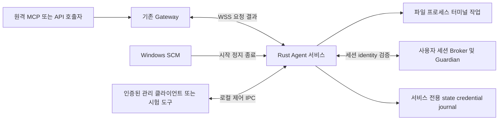

# Rust Agent 서비스 구현 및 검증 작업 계획

> **Document ID**: `DOC-PLAN-AGENT-SERVICE`\
> **Status**: Active · **Target Version**: v0.1.39 source / Agent 서비스 릴리스 인수 미완료\
> **Last Updated**: 2026-10-14 · **Classification**: Service Implementation & Test Plan

## 개요

GUI `apps/client-native`의 재구성은 이 계획에서 제외한다. 대상은 **Rust Agent 자체의 Windows 서비스화와 원격 실행의 신뢰성**이다. 호출자→Gateway→WSS→Agent→실제 작업→결과 반환을 중심으로, 서비스 수명주기·권한·등록·취소·복구·배포 경계의 미완성 작업과 시험을 정리한다.

후속 사용자 요구에 따라 **원격 PC에 연결된 USB·USB 동글·외장 장치의 접근/연결과 정적 분석용 데이터 수집**, **Windows/macOS/Linux 플랫폼 경계 정리**를 포함한다. 동글을 Agent 인증·라이선스 키로 사용하는 요구가 아니다. Windows만 먼저 구현하고 macOS/Linux의 Agent 서비스·외장 장치 어댑터는 미구현 상태로 둔다.

Agent 서비스의 현재 후속 작업은 이 문서가 SSOT다. [Rust 전환 계획](rust-client-migration-plan.md)은 공통 설계 기준, [기존 Client·Agent 통합 계획](native-client-completion-and-test-plan.md)은 이전 범위의 참조로 유지한다. 실제 실행 결과·실패·artifact hash는 [구현 현황](../quality/implementation-status.md)에만 기록한다.

> [!IMPORTANT]
> 이 문서는 2026-10-12 계획서 작성 요청으로 시작했으며, 2026-10-13 사용자가 **계획에 따른 미구현 Agent 기능 진행**을 요청해 source 구현·개발 빌드·격리 시험을 진행한다. 사용자의 **실제 설치 금지** 지시는 유지된다. 문서에 서비스 시험을 기재한 것이 실행 허가는 아니며, 실제 SCM 인수는 별도 요청과 전용 테스트 환경이 필요하다.

## 목차

- [1. 포함 범위와 제외 범위](#section-01)
- [2. 현재 구현 상태와 구체적 공백](#section-02)
- [3. 목표 서비스 구조와 계약](#section-03)
- [4. 미구현·보완 작업 및 우선순위](#section-04)
- [5. 테스트 계획](#section-05)
- [6. 작업 순서와 종료 기준](#section-06)
- [7. 산출물·버전·증거 관리](#section-07)
- [8. 관련 문서](#section-08)

<a id="section-01"></a>

## 1. 포함 범위와 제외 범위

| 구분 | 범위 |
|---|---|
| 서비스 실행 | `apps/agent`, Windows SCM host, startup/readiness/stop/shutdown, 자동 시작·장애 복구 정책 |
| 원격 실행 | Gateway/WSS 연결, 파일·artifact·명령·프로세스·터미널·원격 화면/입력, 작업 상태·취소·정리 |
| 외장 장치/USB 분석 | 원격 대상에 실제 연결된 USB·동글·외장 장치의 탐색/식별·기존 driver 기반 접근·remote handle·지원 데이터 수집·정적 분석 artifact |
| 플랫폼 구조 | 공통 계약/정책/원격 orchestration과 OS adapter 분리. Windows 우선, macOS/Linux 서비스·장치 adapter 미구현 명시 |
| 권한·관리 | 로컬 권한 상한, 현지 승인 계약, observer/controller IPC, 설정 revision, service SID/account·ACL |
| 등록·상태 | 서비스 계정의 enrollment/bootstrap, credential 보호, durable journal, 재연결·재시작·부분 실패 복구 |
| 배포 | GUI 없는 Agent service payload/manifest·SBOM, 설치/등록/등록 입력의 단계 구분, CI 정적 검사 |
| 제외 | Client GUI 코드·화면·IME·트레이·Narrator·레이아웃·UIA, GUI 설치본 재구성, Gateway 웹 화면 재설계 |
| 후순위 | 일반 OS 서비스/레지스트리/작업 스케줄러 CRUD, 새 OS API 전체 확장, 자동 updater, macOS/Linux service |

여기서 **Agent 서비스**는 RACP Agent를 Windows SCM으로 관리하는 것을 뜻한다. 원격으로 다른 Windows 서비스를 관리하는 `services.control` 같은 API 확장과 구분한다. GUI 화면이 없어도 관리·승인 계약과 권한 검사는 유지해야 한다.

원격 desktop 기능의 **사용자 세션 Broker/Guardian**은 Agent의 실행 구성 요소이므로 포함한다. Session 0의 서비스가 사용자 화면을 직접 조작하거나 `client-native` GUI를 상시 실행하는 구조를 전제로 하지 않는다. Gateway/Console은 기존 요청·결과 계약의 통합 시험 대상으로만 사용한다.

첨부된 GUI 재설계 문서는 플랫폼 공통 계층과 OS adapter 분리 원칙을 참고한다. GUI 구현·SVG/i18n/화면 분해 지시를 Agent 작업으로 가져오지 않으며, 첨부 문서의 완료 체크나 크로스 플랫폼 목표를 현재 저장소의 완료 증거로 인정하지 않는다.

<a id="section-02"></a>

## 2. 현재 구현 상태와 구체적 공백

| 영역 | 확인한 코드/상태 | 남은 작업의 분류 |
|---|---|---|
| Agent 공통 실행 | [native_client.rs](../../crates/racp-runtime/src/native_client.rs)에 user run 및 service run, [기존 Agent 실행기](../../scripts/test_native_agent.py)에 격리된 user-mode 원격 검사 존재 | 구현됨. user-mode 결과를 SCM/service-account 결과로 이관하지 않고 서비스 조건 재검증 |
| SCM host | [native_service.rs](../../apps/agent/src/platform/windows/service/native_service.rs)의 dispatcher, STOP/SHUTDOWN cancellation, START/STOP_PENDING checkpoint·readiness 보고 | 구현됨·실제 SCM 검증 필요. OS lifecycle와 온라인 연결 상태 구분 필요 |
| 서비스 identity/state | [service_scope.rs](../../crates/racp-contract/src/service_scope.rs), [native_service.rs](../../crates/racp-core/src/native_service.rs), [machine_service.rs](../../crates/racp-core/src/machine_service.rs) | 고정 identity·경로·private ACL 코드 존재. 계정/접근 권한·Session 0 조건 미검증 |
| provision/bootstrap/관리 | [service_provision.rs](../../apps/agent/src/platform/windows/service/service_provision.rs), [service_bootstrap.rs](../../crates/racp-runtime/src/service_bootstrap.rs), [service_admin.rs](../../apps/agent/src/platform/windows/service/service_admin.rs), [service_config.rs](../../crates/racp-core/src/service_config.rs) | fresh provision·등록·config·pending 처리 코드 존재. 전체 관리 절차와 단계별 실패 인수 부족 |
| maintenance/restore | [service_restore.rs](../../apps/agent/src/platform/windows/service/service_restore.rs), [service_maintenance.rs](../../crates/racp-runtime/src/service_maintenance.rs) | 일부 복구 경로 존재. 미확정 partial 상태 처리와 제품 전체 복구 흐름 미완성·미검증 |
| 로컬 IPC/승인 | [local_ipc](../../crates/racp-runtime/src/local_ipc/mod.rs), [로컬 IPC 계약](../../crates/racp-contract/src/local_ipc.rs)에 인증·observer/controller 및 제어 메시지 존재 | `native-control`/`native-service-control`이 같은 인증 IPC를 소비. 실제 service observer/controller 인수는 보류. 승인 검사는 유지 |
| 서비스 단독 payload | service host·provision·관리·restore는 `pin_current_agent_service_payload()`를 호출. [현재 BASE_FILES](../../crates/racp-contract/src/distribution.rs)는 `racp-client.exe`를 필수로 포함 | 명시 `native-agent-service` 역할의 3-file manifest를 별도 admission. standalone `build/`와 서비스 `staging/payload/`를 구분. 실제 SCM 인수는 별도 |
| 머신 설치 recipe | [native-machine-installer.nsi](../../xtask/native-machine-installer.nsi)는 Agent만 복사하며 Client EXE/shortcut을 생성하지 않음 | Agent 전용 recipe source를 정의. 실제 설치·SCM/계정/ACL 인수는 보류 |
| 시작/장애 정책 | provision/restore의 SCM 생성·복구 경로는 `SERVICE_DEMAND_START` 사용 | 자동 시작·failure actions와 retry 정책을 제품 운영 기준으로 확정하고 검증할 필요 |
| desktop 세션 | [service_session.rs](../../crates/racp-runtime/src/providers/desktop/service_session.rs)·[session_ledger.rs](../../crates/racp-runtime/src/providers/desktop/session_ledger.rs) 및 recovery 경로 존재 | 사용자 세션 등록과 자동 세션 launch를 구별. 코드 존재를 로그인/잠금/세션 전환 합격으로 해석하지 않음 |
| USB/외장 장치 접근 | 현재 Agent/core/runtime와 공개 계약에서 USB·동글 탐색/연결/정적 수집 Provider를 확인하지 못함 | **미구현**. 파일 읽기·process memory·PCAP이 USB 장치의 protocol/firmware 접근을 대신하지 않음 |
| OS 코드 배치 | Agent 앱 루트의 Windows service/setup 파일, core/runtime의 cfg 분기와 일부 기능별 windows.rs 존재 | 부분 분리 상태. 앱 서비스와 shared OS backend의 역할별 플랫폼 경계를 정리할 필요 |
| macOS/Linux | 일부 POSIX terminal/process 코드는 있으나 Windows service와 같은 독립 서비스/IPC/장치 adapter의 완료 증거 없음 | 이 계획의 service/device adapter는 **미구현·보류**. 공통 코드 존재나 디렉터리 생성만으로 지원 완료 표시 금지 |

> [!NOTE]
> `crates/racp-runtime/src/native_client.rs`라는 파일명은 기존 backend 모듈명이며 GUI 앱 자체가 아니다. 필요한 공통 runtime은 재사용하되 `apps/client-native` 실행 파일을 서비스 시작/등록/원격 작업의 필수 dependency로 두지 않는다. 폴더 이름 변경이나 새로운 crate 분할 자체를 목표로 삼지 않는다.

<a id="section-03"></a>

## 3. 목표 서비스 구조와 계약



### 3.1 서비스 identity와 저장 경계

- 현재 코드의 서비스명 `RACPNativeAgent`, 실행 계정 `NT SERVICE\RACPNativeAgent`와 service SID 검증을 기준으로 한다. 실제 서비스 계정과 일시적인 SYSTEM setup helper를 혼동하지 않는다.
- machine image는 현재 코드의 Program Files 경계, state는 `%ProgramData%\RACP-Native-Service` 경계를 기준으로 한다. Agent-only 배포로 바꾸면서 경로/manifest kind를 변경할 필요가 있으면 AS01에서 명시한다. 기존 설치를 자동 채택하거나 재구성하지 않는다.
- credential은 실제 서비스 identity에서 읽고 보호할 수 있어야 한다. 일반 사용자 DPAPI credential을 복사하여 서비스 등록으로 간주하지 않는다. token·로컬 Device state는 package에 넣지 않는다.
- observer/controller를 SID와 session으로 구분하고 최소 필요한 파일/IPC 권한만 부여한다. service account가 SYSTEM이거나 무제한 권한이라는 가정으로 작업을 통과시키지 않는다.

### 3.2 GUI와 독립된 관리·승인 계약

기존 IPC/CLI 계약을 재사용해 status·policy/config revision·승인 요청/결정·작업 취소·정리 상태를 검사하는 headless 관리 경로를 확정한다. 이를 검증하는 도구는 `client-native`를 실행하지 않는다. 새 GUI는 이후 이 계약의 소비자로 연결할 수 있지만 구현/화면 시험은 이 계획에 포함하지 않는다.

승인자가 연결되지 않았을 때 승인 필요 요청을 자동 허용하지 않는다. 정해진 만료/거부 결과를 반환하고 무단 부작용이 없어야 한다. Gateway에서 허용한 권한도 Agent의 로컬 상한을 넘을 수 없다. 등록·설정 변경·service 관리 명령의 actor와 권한을 일반 원격 작업의 권한과 구분한다.

### 3.3 서비스 상태와 실행 결과

SCM의 RUNNING, 로컬 runtime/IPC READY, Gateway ONLINE을 서로 다른 상태로 표시한다. Gateway가 일시적으로 오프라인이어도 재접속 가능한 서비스인지, 영구 auth/config 실패로 시작을 중단해야 하는지 구분한다. command 접수 성공을 실제 작업 성공으로 판정하지 않는다.

설치 파일 배치→서비스 provision→서비스 계정 등록/bootstrap→READY/ONLINE은 구분된 단계다. 각 단계의 실패/미확정 상태를 기록하고 재시도 가능 여부를 정의한다. 부분 실패를 신규 등록 재시도나 기존 service 강제 덮어쓰기로 해결하지 않는다.

### 3.4 플랫폼별 폴더·파일 구조 개선

아래는 **목표 구조**다. `apps/agent` 및 Windows service/setup 경계는 source에 반영했으며, 나머지 runtime/core 재배치는 필요한 backend부터 점진적으로 진행한다. 공통과 OS adapter를 현재 crate 책임 안에서 구분한다. OS마다 Agent 앱이나 동일 정책 엔진을 복제하지 않는다.

Agent 앱 디렉터리는 구현 언어 대신 제품 역할을 나타내는 **`apps/agent`**로 통일한다. AS15에서 기존 `apps/agent-rust`를 `apps/agent`로 변경했다. 언어와 dependency는 `Cargo.toml`과 `.rs` 파일로 식별한다. Cargo package 이름과 실행 파일 이름 `racp-agent`는 유지하고 공유 라이브러리는 기존 `crates/racp-*`에 둔다.

경로 변경 시 root Cargo workspace member와 path dependency, 빌드/패키징·version 도구·migration inventory, CI, 검사 스크립트, AGENTS 및 활성 문서의 source 링크를 함께 갱신한다. 현재 구현 근거인 §2의 링크는 이동한 실제 경로를 가리킨다. 과거 검증 기록의 source 경로·기존 artifact manifest/hash는 당시 증거로 보존하며 배포 출력 `dist/agent`는 유지한다.

```text
apps/agent/src/
├── main.rs                          # entry point 및 mode 선택
├── cli/                             # 인수/schema 검증과 command dispatch
├── application/                     # 등록·실행·관리 orchestration
└── platform/
    ├── mod.rs                       # cfg 선택과 구현 상태 노출
    ├── windows/
    │   ├── mod.rs
    │   ├── service/                 # SCM host/provision/admin/restore
    │   └── setup/                   # image 보호·SYSTEM handoff
    ├── macos/                       # 미구현·후순위 서비스 adapter
    └── linux/                       # 미구현·후순위 서비스 adapter

crates/racp-runtime/src/
├── agent/                           # 공통 원격 실행·등록·수명주기
├── providers/
│   └── hardware/                    # 공통 remote device session/수집 orchestration
└── platform/
    ├── windows/                     # IPC·process·ConPTY·desktop·USB backend
    │   └── hardware/                # enumeration/driver/HID/WinUSB/vendor adapter
    ├── macos/                       # 서비스/장치 backend 미구현
    └── linux/                       # 서비스/장치 backend 미구현

crates/racp-core/src/
├── policy.rs / approval.rs          # 공통 정책·승인
├── journal* / state_schema.rs       # 공통 기록·상태 계약
└── platform/
    ├── windows/                     # credential/ACL/file identity/service state backend
    ├── macos/                       # 서비스용 저장·identity adapter 미구현
    └── linux/                       # 서비스용 저장·identity adapter 미구현
```

AS15에서 `native_service.rs`, `service_provision.rs`, `service_admin.rs`, `service_restore.rs`를 앱의 `platform/windows/service/`, `machine_install.rs`, `machine_setup.rs`를 `platform/windows/setup/`로 이동했다. shared crate의 Win32 OS 호출은 해당 crate의 Windows backend로 점진적으로 분리하되 기존 기능별 `windows.rs`를 의미 없이 중복하지 않는다. 공통 Provider는 target Device·권한·timeout·취소·artifact 흐름을 담당하고 driver handle/OS IO는 platform backend가 담당한다.

공개 Rust/IPC 계약은 가능한 유지하며 module export로 이동 범위를 제한한다. 기존 GUI 소비자를 깨뜨리지 않기 위해 GUI source를 동시에 재작성하지 않는다. `platform/windows` 밖 공통 계층에 Win32 의존성을 추가하지 않고 Cargo의 target-specific dependency와 `cfg(target_os)`로 선택한다. 새 crate나 고정 LOC 목표를 구조 개선의 필수 조건으로 만들지 않는다.

| 플랫폼 | Agent service / device adapter 목표 | 이번 실행 정책 |
|---|---|---|
| Windows x64 | SCM·Named Pipe·service SID·DPAPI/ACL·ConPTY·사용자 세션 backend·USB 접근 | 유일한 우선 구현/검증 대상. 실제 설치/서비스 등록/driver 변경은 금지 유지 |
| macOS | 향후 launchd·OS credential/IPC·장치 접근 adapter | **미구현**. 공통 계약과 adapter 경계만 계획; native build/실행 없음 |
| Linux | 향후 systemd·OS credential/IPC·장치 접근 adapter | **미구현**. 공통 계약과 adapter 경계만 계획; native build/실행 없음 |

미구현 target은 구현 상태/unsupported 오류를 명시한다. 빈 stub가 READY나 Supported를 반환하게 만들지 않는다. 일부 POSIX 공통 코드가 존재하더라도 서비스 제품 전체가 지원된다고 표시하지 않는다.

### 3.5 원격 USB·동글·외장 장치 연결과 정적 분석

USB 동글을 **원격 분석 대상 장치**로 취급한다. Agent 서비스에 라이선스 dongle 필수 조건이나 동글 기반 로그인 정책을 추가하는 요구로 해석하지 않는다.

> [!NOTE]
> 이전 Python Agent에는 Ghidra/GDB 리버싱 Provider, CDB 원격 디버거 및 양방향 native/proxy 중계가 있었다. 이는 USB 전용 장치 접근 구현과 구분한다. Python 폐기 직전 snapshot과 확인 가능한 Agent 이력에서는 USB 탐색·직접 IO·동글 데이터 수집 전용 코드를 찾지 못했다. 확인 범위와 근거는 [구현 현황](../quality/implementation-status.md)에 기록한다. AS16–AS18 착수 시 기존 Rust 리버싱·중계·파일/artifact 경로의 재사용 가능성과 원격 제조사 도구 실행으로 충족되는 범위를 먼저 확인하고, 실제 공백인 장치 adapter만 추가한다. 기존 기능을 전부 신규 구현하거나 USB 기능이 Rust 전환에서 유실됐다고 단정하지 않는다.

| 단계 | 원격 기능 목표 | 경계/결과 |
|---|---|---|
| 1. 탐색·식별 | USB topology/interface·VID/PID·serial(존재 시)·장치 class·driver/backend·연결 상태 열람 | Agent의 PC `device_id`와 외장 장치 ID를 구분. VID/PID만으로 물리 장치를 유일하게 식별하지 않음 |
| 2. 접근 가능성 판정 | 현재 driver·service account ACL·사용 중인 interface·지원 backend로 가능한 작업 표시 | 발견 성공과 IO 연결 가능을 분리. WinUSB/HID/vendor/class backend를 실제 장치 조건에 따라 선택 |
| 3. 원격 연결 | Agent 쪽 장치/interface handle을 열고 호출자에 opaque session handle과 lease 반환 | remote caller·Agent boot·장치 connection generation에 binding. 실제 OS handle을 외부에 그대로 노출하지 않음 |
| 4. 정적 수집 | descriptor/interface/endpoint 정보, 장치 연관 driver/firmware 파일, 지원 protocol로 읽을 수 있는 장치 데이터·firmware image 수집 | 요청한 장치와 범위·read method·driver version·시각·수집 한도/결과/hash를 manifest로 기록. 읽을 수 없는 항목은 unavailable/unsupported로 구분 |
| 5. 분석 artifact | 수집 bytes/파일을 spool→Gateway artifact로 전달하여 host 측 정적 분석 도구에 연결 | 원본·Device/interface identity·SHA-256·부분 수집 여부 보존. host 분석 성공과 장치의 live IO 지원을 구분 |
| 6. 연결 종료 | close/cancel/timeout/unplug/Agent restart 때 장치 세션 폐기 | replug 뒤 stale handle로 다른 장치에 접근하지 않음. pending IO 취소·lease/handle 정리와 실패 상태 반환 |

RPC 이름은 계약 설계 때 확정한다. `enumerate → inspect → open → acquire → artifact → close`가 목표 흐름이며 현재 등록된 operation이라고 표시하지 않는다. metadata 조회, 지원 장치의 분석 데이터 수집, 장치 상태 변경을 권한·승인으로 구분한다. 처음에는 탐색/descriptor/분석 artifact 수집을 구현하고 임의 write/reset/firmware flash·driver 교체·OS 전체 USB passthrough는 별도 요청 전 범위에 넣지 않는다.

Windows의 WinUSB 접근은 해당 interface의 function driver 조건을 만족해야 하고 descriptor 읽기는 firmware 추출 API와 다르다. 모든 USB dongle에 공통적인 firmware dump가 가능하다고 약속하지 않는다. HID/vendor SDK 또는 문서화된 read protocol이 필요한 장치는 별도 backend를 선택하며, Service가 해당 handle을 열 수 있는지 검사한다. [Microsoft WinUSB 접근 조건](https://learn.microsoft.com/en-us/windows-hardware/drivers/usbcon/using-winusb-api-to-communicate-with-a-usb-device), [표준 USB descriptor](https://learn.microsoft.com/en-us/windows-hardware/drivers/usbcon/standard-usb-descriptors).

control transfer의 IN 방향이나 endpoint read만으로 부작용이 없다고 가정하지 않는다. 대상 장치에서 확인한 수집 protocol/요청의 범위와 예산을 계약으로 명시한다. 제조사·모델·장치 class와 현재 driver는 구체적 backend를 선정할 입력이며, 제시되지 않은 장치도 전부 지원한다고 선언하지 않는다. 일반 원격 USB 연결은 Agent-mediated IO를 뜻하며, 관리 PC에 USB device를 가상으로 attach하는 USB-over-IP 제품을 자동으로 구현하는 것은 아니다.

<a id="section-04"></a>

## 4. 미구현·보완 작업 및 우선순위

P0는 Agent 서비스의 독립 실행·원격 제어·권한/정리 경계, P1은 운영 신뢰성·세션·빌드, P2는 배포 복구/선택 기능, P3는 명시적으로 요청된 확장이다. 아래는 계획이며 코드가 존재하는 항목은 시험부터 수행하고 실패한 경로만 수정한다.

| ID / 우선순위 | 작업 종류와 대상 | 작업 및 완료 조건 |
|---|---|---|
| AS01 / P0 | **source 구현: GUI 없는 서비스 payload admission / SCM 인수 보류** | Agent-only service manifest/허용 파일/PE target/hash/SBOM과 machine receipt를 정의. service host·provision·maintenance·restore가 같은 역할의 payload를 검증하도록 연결. `racp-client.exe` 부재 상태에서 서비스 경로가 admitted되며 무결성 검사를 약화하지 않음 |
| AS02 / P0 | **source 구현·user-mode 검증: headless 관리·승인 / service 계정 인수 보류** | 기존 로컬 IPC/CLI의 observer/controller·policy/config CAS·승인 결정·cancel/status/event를 시험 도구에서 사용 가능하게 정리. 재구성 예정 GUI를 요구하지 않으며 승인자 부재/만료/재사용/미인가 controller가 실제 실행을 허용하지 않음 |
| AS03 / P0 | **구현됨·검증 필요: 서비스 등록/credential** | fresh provision→bootstrap→enrollment→보호 저장→입력 정리의 전체 흐름과 중단 지점 검사. virtual account에서 재시작 후 credential 사용 가능, 일반 사용자 credential import 없음, token 소모 뒤 불확실한 등록 재실행 없음 |
| AS04 / P0 | **구현됨·검증 필요: SCM lifecycle/readiness** | START_PENDING/READY/RUNNING·STOP_PENDING/STOPPED 및 오류/체크포인트 검사. 시작 중 취소·SCM STOP·OS SHUTDOWN이 같은 정리 경로에 도달. 네트워크 오프라인과 초기화 실패를 구분하고 확인되지 않은 정리를 정상 종료로 보고하지 않음 |
| AS05 / P0 | **구현됨·서비스 조건 검증 필요: 원격 핵심 작업** | 실제 MCP/API→Gateway→service Agent의 파일/전송·명령 stdout/stderr/exit·process·ConPTY 작업을 검사. service account의 workspace/executable 권한과 실제 부작용·최종 결과 일치. 다른 Device·폴더·process를 실행 대상으로 채택하지 않음 |
| AS06 / P0 | **구현됨·검증 필요: journal/멱등성/재연결** | ACK·결과 유실, Agent/Gateway 재시작, 중복·충돌·정책 변경·취소 경합 검사. 동일 변경 중복 실행 없음, 완료 결과 불변, 불확실한 부작용은 UNKNOWN 보존. 재연결 자체를 작업 성공으로 보지 않음 |
| AS07 / P0 | **구현됨·검증 필요: drain/자원 정리** | STOP/취소/revoke/lease 만료/단절 때 소유 child tree·ConPTY·stream·Broker/Guardian·입력 lease를 추적. 종료 예산과 정리 불확실성의 durable 기록을 확인. 소유하지 않은 process/session에 영향 없음 |
| AS08 / P1 | **부분 구현: 미생성 restore intent 검사·CAS 취소 및 typed provision receipt 검사 / partial provision 인수 미완료** | helper/state/SCM 생성/ACL/bootstrap/config 변경 단계별 실패를 재현하고 pending/실제 상태/CAS를 대조. 안전한 중단·명시 복구·재시도 가능한 상태와 현지 확인이 필요한 상태를 구분. 기존 service/root를 자동 채택하지 않음 |
| AS09 / P1 | **부분 구현: NONE recovery readback·durable 일회성 intent·완료 maintenance CAS 재개 / 자동 활성화 보류** | 현재 demand-start와 배포 시 auto-start의 선택, SCM failure actions, crash 재시작·backoff·영구 auth 실패·사용자 stop 후 재시작 여부를 확정. 무한 재시작/중복 Agent/재등록 반복 없음. 실제 부팅/SCM 시험은 설치 금지 해제 후 수행 |
| AS10 / P1 | **source 구현: bounded runtime health·기존 diagnostics 연결 / 서비스 계정 인수 별도** | service/local READY/Gateway 상태, boot ID·최종 오류·작업/queue/spool·cleanup 상태를 bounded status/log로 제공. RPC 거부/승인/취소/복구 원인을 추적하되 credential/token·원문 민감 출력은 노출하지 않음. 이미 연결된 diagnostics API를 재작성하지 않음 |
| AS11 / P1 | **보완·검증 필요: Session 0과 desktop backend** | 사용자 세션 Broker 등록/launch 주체·identity·session 변경·Guardian 정리를 확정. GUI app 없이 세션 backend를 연결/시험. 세션 없는 경우 정직한 unavailable 결과, 잠금/UAC/session mismatch에서 입력 금지, 사용자의 입력 개입 시 원격 입력 해제 |
| AS12 / P1 | **source/staging 구현: Agent 서비스 단독 배포/CI / setup·설치 인수 보류** | AS01 계약에 맞는 서비스 전용 package/recipe/설치 보호·진단 정의를 Git 추적 가능하게 배치. Client EXE/shortcut 없음. `dist/agent` 역할별 manifest/SBOM/해시, pinned compiler와 CI 정적 검사 연결. artifact 생성과 실제 서비스 등록을 별도 단계로 유지 |
| AS13 / P2 | **미완성: 업데이트/제거·버전 복구 제품 흐름** | protected image·service command·state schema·pending 전환의 호환성, 기존 버전 보존·rollback/UNKNOWN·정리 확인·명시 detach 조건을 정의. helper restore 코드와 완결된 updater를 구분. 실제 교체/제거는 전용 환경과 별도 실행 요청 후 검사 |
| AS14 / P3 | **미연결 확장** | 현재 catalog의 일반 서비스/registry/tasks/software·storage·memory write 등은 실제 사용 요구가 있을 때 선택. 새 OS object/API 전체를 AS01–AS12의 완료 조건에 강제하지 않음. 선택 runtime·타 OS도 요청된 범위만 추가 |
| AS15 / P0 | **Agent 앱 Windows 경계 구현: 공유 backend는 점진 작업** | `apps/agent-rust`→`apps/agent` 변경과 Cargo·빌드/패키징·version/inventory·CI·검사 스크립트·AGENTS·활성 문서 참조를 같은 작업에서 갱신. §3.4에 따라 Windows service/setup 파일과 신규 hardware backend부터 책임별 이동/배치. package/EXE `racp-agent`·공개 계약·권한·동작 유지, Windows build/회귀 확인. macOS/Linux service/device는 미구현 명시; 코드 복제·불필요한 crate 분할·타 OS build 없음 |
| AS16 / P1 | **부분 source: identity/lease·Windows metadata RPC / native open·실장치 인수 미완료** | §3.5의 ID/interface/backend/capability·opaque session/lease·권한을 정의하고 Windows enumeration/inspect/open/close와 protocol 연결. 발견/연결/수집 지원 상태를 구분, 다른 Agent/boot/replug generation의 handle 거부 |
| AS17 / P1 | **부분 source: 수집 provenance·기존 spool bridge / 실제 read backend 미연결** | descriptor와 연관 파일 수집부터 구현하고 선정된 장치의 지원 read protocol/vendor backend를 추가. bounded IO·부분 수집·artifact hash/provenance·host 분석 연동 확인. 임의 firmware dump나 물리 memory 접근을 보편 지원으로 주장하지 않음 |
| AS18 / P1 | **부분 source: generation·cancel/deadline·cleanup 상태 모델 / native IO 인수 미완료** | unplug/replug·busy/access denied·timeout·worker crash·서비스 stop/restart 때 pending IO와 장치 handle/lease 정리. stale identity·다른 장치 재사용 거부. driver 설치/교체·장치 reset/write는 수행하지 않음 |

AS01/AS12의 서비스 payload를 만들기 위해 기존 Client payload의 필수 파일 검사를 단순히 없애거나 모든 폴더를 허용하지 않는다. 역할을 명시한 계약·허용 파일·hash/ACL 검증을 유지한다. AS02는 승인 우회나 비인증 관리 API 추가를 의미하지 않는다.

AS09 source의 기본 정책은 **demand-start 유지와 recovery 비활성화**다. 신규 provision 및 명시 restore가 만든 fixed-name service에 `none` action·non-crash recovery false·빈 command/reboot text를 명시하고 query로 다시 확인한다. 새 restore는 disabled 정의에 먼저 적용해 일회성 maintenance 재시작을 막고 STOPPED 검증 뒤 finalization에서 다시 확인한다. bounded crash-only profile은 5초/30초/120초 재시작·마지막 `none`·24시간 무실패 reset 계약과 Win32 변환만 준비했으며 **SCM 활성화/CLI opt-in에는 연결하지 않는다**. 일회성 configure/reconcile/recover_sessions/remove가 crash 뒤 정상 Agent 실행으로 바뀌지 않도록 기본 recovery를 계속 끈다. 이미 queue된 SCM 재시작은 STOPPED 보고만으로 취소되지 않으므로 명시 disabled·durable startup gate·관리 전환/중지 orchestration을 갖춘 뒤에만 opt-in/auto-start를 연결해야 한다. 계약/Win32 변환·readback 실패 시험→보수적 provision/restore 연결→Windows compile/회귀→증거 기록 순서이며, 실제 SCM API 실행은 설치 금지 해제 전 수행하지 않는다.

AS09의 다음 실행 경계 묶음은 durable 일회성 start intent다. 공통 typed intent/phase는 contract, pinned 파일·CAS·claim/receipt 저장은 core, SYSTEM handoff와 SCM 시작 인수·service actor 실행은 Agent Windows adapter에 둔다. configure/reconcile/recover_sessions 및 remove/restore의 maintenance는 UUID intent 인수만 넘기며, private root identity에 묶인 prepared→claimed→completed→acknowledged를 사용한다. claim은 효과 전에 persist하고 claimed/failed intent를 자동 재실행하거나 정상 Run으로 채택하지 않는다. 완료 receipt hash와 stopped/PID 0 확인 뒤에만 SYSTEM이 acknowledge한다. crash 뒤 completed receipt 확인/acknowledge와 준비 단계의 명시 abort는 별도 CAS 관리 요청으로 제공하고, claimed/failed 불확실성은 보존한다. 계약·중복 claim/crash/다른 root/변조/receipt CAS RED–GREEN→Windows host/admin/maintenance 연결→회귀·개발 payload→main 커밋 순서다. 자동 restart/boot 활성화 및 실제 SCM 시험은 이 gate만으로 완료를 선언하지 않는다.

관리 helper의 `inspect_start_intent`는 private root의 typed snapshot/sha256을 반환한다. `abort_start_intent`는 `request_id`/`expected_sha256` CAS로 prepared만 취소하며, `acknowledge_start_intent`는 completed configure/reconcile/recover_sessions의 현재 receipt와 stopped/PID 0/exit 0/NONE recovery 확인 뒤에만 정상 Run을 허용한다. completed maintenance에는 일반 acknowledge를 적용하지 않는다. 제거·복원의 마지막 SYSTEM 처리가 실패하면 기존 `remove_service`/`restore_service` 입력에 **`resume_request_id`와 `resume_expected_sha256` 두 필드**를 추가해 동일한 completed purpose만 명시 재개한다. 현재 owned service 정의·실행 파일·stopped/PID 0/exit 0·NONE recovery 및 receipt/config/device를 다시 확인하고 final lock 아래 현재 state/schema/credential 존재·pending 상태를 확인한다. maintenance, 등록, bootstrap은 다시 실행하지 않는다. 제거는 DeleteService 뒤에도 barrier를 보존하고 namespace 부재를 확인한 restore만 이를 소비한다. 복원은 demand-start readback/release publish/receipt 작성 뒤 CAS acknowledge한다. 새 restore 정의에는 disabled 상태에서 NONE recovery를 먼저 설정한다. unregistered 사전검사의 allowlist에는 정확한 start-intent 파일과 세 lock 파일만 추가한다.

> [!WARNING]
> claimed/failed outcome은 자동 해제하지 않는다. 일반 inspect/abort는 설치된 stopped service를 요구하며, service 생성 전 실패한 prepared restore만 아래 AS08의 sealed-root 경로로 검사/취소한다. 그 외 namespace 없는 root의 일반 복구와 실제 SCM/가상 계정 시험 및 queued restart·boot admission은 미완료다.

첫 service bootstrap의 등록 예약은 service actor/config 확인 뒤 실행 gate의 네 고정 파일만 추가 허용한다. intent의 정상 Run 허용 phase를 다시 확인하며 미확정 intent는 token 소비 전에 차단한다. unregistered restore 후 남은 고정 maintenance/restore/detach·config/agent/settings lock은 **Acknowledged Restore와 현재 maintenance receipt hash/nonce·config hash·registered=false/device=null/state-preserved/credential-unread**가 확인된 경우에만 허용한다. 일반 사용자 등록의 empty-root 검사는 그대로 유지하고, 임의 파일·미완료/다른 purpose·변조된 receipt로 등록을 재개하지 않는다.

AS08의 첫 복구 경계는 `inspect_restore_intent`와 `abort_uncreated_restore`다. 요청 계약은 공통 contract, prepared Restore 전용 CAS 전이는 core, SYSTEM/SCM 증거는 Windows adapter에 둔다. 두 요청은 `expected_config_sha256`을 요구하며 `NativeServiceConfig::read_restore`의 고정 machine root·sealed SID/private ACL·config hash 검증 뒤 ADMIN→EXECUTION→config/agent lock을 유지한다. inspect는 bounded snapshot과 namespace `absent`/`present`/`unconfirmed`를 보고하고 의도 파일을 바꾸지 않는다. abort에는 추가 `request_id`/`expected_sha256`을 요구하며 **SCM의 고정 이름 조회에서 정확히 ERROR_SERVICE_DOES_NOT_EXIST가 나온 경우에만** Prepared Maintenance Restore를 Aborted로 CAS 전이한다. namespace 증거를 JSON으로 받지 않고 SDK error를 handle cleanup 전에 보존한다. 기존 service, 접근 거부, 삭제 대기, 알 수 없는 오류 및 claimed/failed/completed·다른 purpose·stale ID/hash는 해제하지 않는다. 취소 후에는 새 UUID의 명시 restore가 필요하며 늦게 온 이전 start는 claim할 수 없다. 이 요청은 service 생성/시작/중지/제거/재설정·credential 읽기·재등록을 하지 않는다. 계약/phase/CAS/namespace 분류와 실제 파일 불변 시험 RED–GREEN→SYSTEM handoff 연결/검토→Windows 회귀·개발 payload→main 순서로 검증한다. 보호 config를 만들기 전의 partial provision, 이미 생성된 불확실한 service 및 실제 SCM 인수는 별도다.

AS07 Browser 시작 실패 정리는 정상 close와 같은 부모 signal/Job tree-empty 확인 뒤에만 owned profile을 삭제한다. marker persist·CDP 연결·backend query·proxy/context 생성 실패에 적용하며, 5초 종료 budget이나 proof 조건을 약화하지 않는다. 종료 확인 불가에는 profile/기존 recovery marker를 보존하고 cleanup 실패를 반환한다. 아직 inventory에 들어가기 전의 startup 정리가 실패하면 Provider ready도 false로 유지해 새 요청/전체 cleanup 완료를 차단한다. 이 gate 보완과 간헐 parent signal 지연 원인 규명은 별개이며, recovery enumeration과 birth 조회 사이 exit race 및 부하 조건은 계속 검증해야 한다. main 통합은 동시 Slint GUI 작업이 완료·커밋된 뒤 진행한다.

AS07의 대기 중 open/attach는 opening lock 획득 후 준비 상태를 다시 검사한다. Windows 재시작 복구는 읽기 전용 process handle을 고정해 같은 객체의 생성 시각과 종료 signal을 확인하며, 생성 시각 불일치/PID 재사용/live actor 불일치/조회 불확실성에는 profile을 보존한다. 이미 종료된 동일 객체를 살아 있는 PID 조회 실패로 처리하지 않는다. parent 종료 증명과 Job empty를 모두 요구하고 종료 예산은 그대로 유지한다. 실제 SDK의 owned subprocess·queued admission 회귀는 설치 없이 수행하며, 기존 간헐 termination 지연의 원인 규명/부하 인수와 구분한다.

AS16–AS18의 설치 없는 첫 묶음은 공통 hardware target/lease/read plan/IO request·수집 manifest 계약과 core inventory/session 모델이다. PC Device ID와 별도 opaque hardware/interface/generation ID를 사용하고 caller/boot/workspace/lease와 IO operation/read plan을 binding한다. 완전한 bounded snapshot만 publish하고 unplug/replug·metadata 교체·알림 연속성 유실 때 기존 target을 거부한다. 단조 lease/IO deadline·pending/bytes/actor quota·stop admission·cancel/unknown cleanup 상태를 검증한다. timely/uncancelled/current-generation completion만 외부 JSON으로 만들 수 없는 수집 receipt를 생성한다.

Windows adapter는 `crates/racp-runtime/src/platform/windows/hardware.rs`에 USB PnP interface 탐색 source와 bounded SDK buffer/UTF-16/Hardware ID decoder를 둔다. opaque interface path는 parse하지 않고 PnP Hardware IDs에서만 VID/PID를 읽는다. 시작/NativeProviders/RPC에 연결하지 않으며 실제 SDK 탐색은 이번 시험에서 실행하지 않는다. HID/WinUSB/vendor open·driver IO·notification continuity 및 preemptible worker는 후속이다. AS17은 receipt에 묶인 bytes·SHA/부분 수집·method/target을 한 JSON artifact로 만들어 기존 OutputSpool/재시도 경로를 재사용하고 host가 verify/extract할 수 있게 한다. emission fence·실제 backend 지원 profile·RPC permission admission과 연결하기 전 원격 USB 사용 가능이라고 선언하지 않는다. descriptor fixture를 실제 firmware dump 인수로 기록하지 않는다.

Windows PnP 탐색의 후속 경계는 고정 `hardware-discovery-worker`다. parent는 현재 Agent EXE만 Job containment/256 MiB 제한 아래 실행하고 timeout/cancel에 owned tree 종료와 parent signal을 확인한다. child 입력은 128 bytes/timeout 1–30000 ms만 허용하며 raw path/driver/action/실행 파일 선택은 받지 않는다. stdout은 private snapshot에 한해 4 MiB, stderr와 기존 worker output은 16 KiB 제한을 유지한다. snapshot은 최대 256개/중복/locators/unknown fields를 검증한 후만 core에 전달한다. parent deadline을 지났거나 종료 증명이 불확실하면 데이터 성공을 보고하지 않는다. 이 worker는 명시 CLI 내부 mode이며 startup/NativeProviders/Gateway RPC에는 미연결이다. 이번에는 decoder/model/인수만 시험하고 실제 worker 탐색을 실행하지 않는다.

<a id="section-05"></a>

## 5. 테스트 계획

### 5.1 설치 없이 준비 가능한 시험

아래 시험은 구현 요청에 따라 설치 없이 수행할 수 있는 범위부터 실행한다. 실제 실행 증거는 구현 현황에 기록한다. 향후 작업 요청 시 Agent-only artifact와 임시 state/Gateway·인증된 시험 controller를 사용한다. user-mode 또는 모델 시험의 한계를 기록하며 SCM 합격으로 표현하지 않는다.

| ID | 대상 | 절차 및 합격 기준 |
|---|---|---|
| AST01 | source/계약/역할 경계 | Agent/core/runtime의 compile·format·protocol/version/permission binding 검사. service payload의 Client app dependency 부재, 동일 역할의 manifest 검증과 command schema 일치 |
| AST02 | package admission | Agent service manifest·파일/PE target/hash/SBOM, 손상·추가 파일·잘못된 kind/OS/arch·link 경로 거부 검사. credential/state/runtime 미포함. installer EXE는 실행하지 않음 |
| AST03 | headless IPC 관리 | 임시 endpoint와 인증 controller로 status/event·policy CAS·승인/cancel 검사. observer는 변경 불가, SID/session/actor mismatch·stale revision 거부, GUI app 호출 없음 |
| AST04 | 원격 종단 기본 작업 | 독립 Gateway/WSS에서 Device 등록→허용 폴더 read/write·artifact hash→명령 exit/stdout/stderr→ConPTY open/write/read/resize/close 확인. 실제 부작용과 반환 결과 일치 |
| AST05 | 원격 권한·승인 | allow/deny/승인/거부/만료/결정 재사용·승인자 부재·작업 중 policy 축소 확인. 거부된 변경은 부작용 없음, 인증된 controller 결정만 적용 |
| AST06 | 작업 상태·멱등성 | request/operation ID, 중복 key·다른 payload 충돌, ACK/결과 유실·cancel 경합 확인. 변경 실행은 한 번, final 결과 불변, UNKNOWN이 성공으로 바뀌지 않음 |
| AST07 | 네트워크·재시작 | Gateway unavailable·연결 중단·TLS/auth 오류·Agent 재시작·credential revoke를 임시 환경에서 검사. bounded retry와 상태 보존, 임의 재등록·중복 resource 생성 없음 |
| AST08 | 자원·장애 조건 | owned child/ConPTY/stream 종료, timeout·spool/디스크/출력 한도·malformed request·worker crash 검사. Agent 생존, 예산 준수와 실패 이유 반환, 미소유 process 종료 없음 |
| AST09 | 문자·경로/데이터 | 원격 한글·공백 경로/argv·stdout/stderr·터미널·binary artifact hash 확인. 정확한 값/bytes가 대상과 호출자 사이에 보존됨. Client GUI 입력/IME 시험은 없음 |
| AST10 | bootstrap/config 상태 모델 | duplicate key·schema/hash/revision 변조, pending journal 전환·중단 시점·잘못된 actor를 모델/단위 시험으로 검사. 알려진 상태만 재시도, 미확정 부작용은 유지. 실제 SYSTEM/DPAPI 인수와 구분 |
| AST11 | 진단·로그/비밀 정보 | 원격 request·거부·승인·cancel·cleanup 오류를 status/audit에 연결. token/credential/민감 원문이 응답·argv·로그·package에 노출되지 않음 |

### 5.2 실제 SCM 인수 — 현재 보류

> [!WARNING]
> 아래 시험은 서비스 설치/등록·OS lifecycle 변화가 필요하다. 현재 실제 설치 금지 지시로 모두 보류한다. 사용자 PC의 기존 SCM service에 시험하거나 user-mode 실행 결과로 대체하지 않는다. 수행 시 fresh 전용 Windows 환경, 기존 서비스명 충돌 검사, 테스트 권한과 복구 절차를 먼저 확정한다.

| ID | 서비스 시험 | 절차 및 합격 기준 |
|---|---|---|
| AST12 | 실제 등록/계정/ACL/credential | fresh provision으로 고정 service name/account/SID·image/state/IPC ACL·SCM command 검사. virtual account enrollment 및 보호 credential을 실제 재시작 후 사용. 일반 사용자 접근·credential 복사·기존 service adoption 거부 |
| AST13 | 시작/정지/부팅/로그아웃 | SCM start/stop/shutdown·시작 중 stop·Gateway 오프라인 시작·부팅 자동 시작·사용자 로그아웃 확인. 로컬 READY와 Gateway ONLINE 구분, checkpoint/waitHint·오류 상태 정확, GUI app 없이 Agent 기능 유지 |
| AST14 | 프로세스 crash와 recovery | 실제 service process crash·SCM retry·등록/journal 복구·강제 종료 후 cleanup 검사. 단일 Agent 유지, 재등록/중복 변경 없음, 수동 stop 후 재시작 정책 준수 |
| AST15 | service 권한에서의 원격 작업 | AST04–AST09를 실제 service account에서 실행. workspace·child/ConPTY 권한 차이 확인, least privilege 유지. user-mode 성공을 전용 계정 성공으로 추정하지 않음 |
| AST16 | 사용자 세션 desktop backend | 테스트 사용자 세션의 Broker/Guardian을 GUI 앱 없이 연결. Session 0 직접 입력 금지, 승인된 session/window의 screenshot·handle·click/type 효과, DPI/다중 모니터 좌표·세션 전환·로그아웃·사용자 입력 중단/정리 확인 |
| AST17 | provision/복구/배포 실패 | 파일 배치·SCM 생성·ACL 설정·token 소모·bootstrap 정리·config CAS·서비스 전환의 실패 주입. durable 단계·실제 SCM/state를 대조해 명시 복구/중단. 강제 초기화·재등록·기존 state 삭제 없음 |
| AST18 | 전용 clean-PC 설치/교체/제거 | Agent-only service artifact로 설치·등록·drain·version 전환·명시 detach·제거/state 보존 확인. 서비스 미확정/실행 파일 pin/남은 helper 때 제거 거부. GUI app·개발 runtime 없이 수행 |

### 5.3 환경·운영 시험

| ID | 선행 조건 | 절차 및 합격 기준 |
|---|---|---|
| AST19 | 지정된 두 PC와 원격 테스트 계정/폴더 | 실제 MCP/API→Gateway→대상 Agent의 파일·명령·터미널·승인·취소·단절/복구 확인. loopback과 구분. service-mode 인수는 AST12 이후에만 연결 |
| AST20 | 전용 시간·부하/자원 예산 | 짧은 부하부터 원격 동시 작업·대용량 전송·출력 압박·재연결 반복을 검사. 이후 30분 부하/8시간 soak를 계획하되 예산·warm-up·기준을 사전에 고정. 지속 누수·작업 유실·무한 retry 없음 |
| AST21 | 명시적으로 선택한 runtime | browser/analysis 등 필요한 기능만 실제 도구와 연결. 도구의 service/session 권한·manifest admission·결과·취소·종료 확인. GUI 재구성이나 runtime 자동 설치를 선행 작업으로 추가하지 않음 |

AST19는 이미 승인된 전용 서비스 환경이 없으면 user-mode 원격 확인으로 범위를 제한해 보고한다. AST20/AST21도 수행한 계정·실행 mode와 exact artifact를 기록한다. 시간·PC/runtime 부족은 보류이며 합격이 아니다.

### 5.4 플랫폼 경계와 원격 외장 장치 시험

| ID | 선행 조건 | 절차 및 합격 기준 |
|---|---|---|
| AST22 | AS15 경로/구조 이동 후 Windows artifact | `apps/agent`의 workspace/path dependency·빌드/패키징·version/inventory·CI·검사 스크립트·활성 문서 링크 검사. 활성 실행 참조에 이전 경로가 남지 않았는지 확인하되 과거 증거 참조는 구분. package/EXE `racp-agent`·`dist/agent` 출력·공개 계약/권한/dispatch·Agent-only build·SBOM의 동일 역할 확인. 공통 계층의 Win32 leakage와 macOS/Linux 미구현 capability 검사. 다른 OS를 빌드하지 않음 |
| AST23 | protocol/정책/장치 backend fixture | 장치 ID와 PC ID 구분, composite interface·serial 부재·동일 VID/PID, 허용/거부·승인·lease·handle binding 검사. fixture는 계약/흐름 시험이며 실제 USB IO 성공으로 기록하지 않음 |
| AST24 | 사용자가 지정한 원격 테스트 PC와 실제 USB·동글/외장 장치, 기존 driver | 원격 enumerate/inspect/open/지원 수집/artifact/close의 end-to-end 효과 확인. 실제 장치/driver/backend와 service 또는 user-mode를 기록. driver 교체나 새 서비스 등록은 하지 않으며 실제 service 계정 시험은 설치 금지 해제 후 |
| AST25 | 허용된 테스트 장치/시간, 기존 접근 backend | unplug/replug·busy·access denied·동시 요청·cancel/timeout·Agent stop/restart를 검사. generation이 바뀐 stale handle 거부, pending IO/handle/lease 정리, 다른 장치에 요청 전이 없음 |
| AST26 | 지원 read protocol 또는 장치 연관 파일과 분석 도구 | descriptor/raw bytes/firmware 또는 driver 파일의 범위·출처·SHA-256·부분 수집 정보 확인 후 host 정적 분석. descriptor만 읽은 결과를 firmware dump로 표시하지 않음. unsupported 항목은 실제 제한 이유 반환 |

AST24–AST26의 실제 장치 접근·분리/재연결·수집은 수행하지 않는다. 대상 장치·허용한 read protocol·기존 driver·계정/실행 mode를 확정한 후 수행한다. 동글을 인증키로 사용하는 시험은 이 범위에 없다.

<a id="section-06"></a>

## 6. 작업 순서와 종료 기준

| 묶음 | 수행 범위 | 종료 조건 |
|---|---|---|
| 1. Agent 서비스 독립·플랫폼 경계 | AS15/AS01/AS02, AST01–AST03·AST10·AST22 | Windows service와 공통 경계, GUI 없는 payload·인증 관리/승인 계약 확보. 전체 파일 대이동을 원격 실행의 선행 조건으로 강제하지 않음. 실제 SCM 합격은 별도 |
| 2. 설치 없는 원격 회귀 | AS05–AS07·AS10, AST04–AST11 | 실제 원격 실행·권한·승인·결과·취소·재연결·정리 확인. 동일 PC 및 user-mode 한계 명시 |
| 3. 실제 service 인수 | AS03/AS04/AS08/AS09/AS11, AST12–AST17 | **현재 보류**. 허용된 전용 환경에서 service account/SCM 수명주기와 실제 원격 작업 증거 확보 |
| 4. 서비스 배포/운영 | AS12/AS13, AST18–AST21 | artifact·배포 복구·실제 두 PC·운영 자원 인수. 설치 관련 범위는 계속 별도 실행 허가 필요 |
| 4-A. 요청된 외장 장치 분석 | AS16–AS18, AST23–AST26 | Windows 원격 장치 탐색·연결·지원 데이터 수집·artifact·종료 인수. 현재 driver/장치 조건과 service 인수 보류를 명시 |
| 5. 선택 확장 | AS14 | 실제 요구가 확인된 기능만 계약·권한·Provider·시험 연결 |

계획 실행 시 먼저 실패를 재현하고 필요한 코드만 변경한다. 공통 Agent 기능이나 새 GUI를 처음부터 다시 만드는 작업으로 확대하지 않는다. 별도 agent/thread는 사용자 요청 없이 만들지 않는다.

**Agent 서비스 완료 판정**은 GUI가 없는 payload/관리 경로뿐 아니라 실제 SCM identity·bootstrap·readiness·stop/recovery와 service 계정의 원격 작업·권한·승인·정리 증거를 모두 필요로 한다. 현재 설치 금지로 실제 service 인수가 보류되면 “서비스용 소스/정적 검사 완료” 또는 “user-mode Agent 검증”까지만 보고한다. 자동 업데이트·타 OS·OS API 전체·서명/게시를 핵심 종료 조건에 추가하지 않는다.

<a id="section-07"></a>

## 7. 산출물·버전·증거 관리

- Agent 앱 source의 현재 경로는 `apps/agent`다. `apps/agent-rust`는 과거 검증 이력에만 보존한다. 공유 source는 `crates/racp-contract`, `crates/racp-core`, `crates/racp-runtime`, 필요한 `xtask` 범위에 둔다. `apps/client-native` source/화면/실행을 이 계획의 구현·시험 대상으로 추가하지 않는다.
- 현재 standalone build는 `dist/agent/<version>/win-x64/<build-id>/build/`다. service staging은 같은 Agent batch의 `staging/payload/`, 명시 요청하는 setup artifact는 `packages/`다. `stage-agent-service`, `verify-agent-service`, `package-agent-service`가 각각 개발 빌드·정적 검증·setup 생성 단계이며 실제 설치/등록을 수행하지 않는다.
- Client package는 user scope만 받으며 Agent service staging/recipe는 별도 역할을 사용한다. 기본 제품에 CPython/Node/Electron/Iced GUI·token·credential·Gateway 고정 설정·Device state를 넣지 않는다. 선택 runtime은 별도 admission이다.
- raw evidence는 `dist/verification/agent/<version>/<run-id>/`, 실제 결과·실패·수치·hash는 [구현 현황](../quality/implementation-status.md)에 기록한다. mode(`user`/`service`/`model`), 계정/SID 역할, source/lock, 기대/실제 결과, 자원 정리를 포함하며 비밀 값은 제외한다.
- 구현/build batch의 버전·재시도·출력 보존은 [AGENTS](../../AGENTS.md)를 따른다. 문서 작성만으로 v0.1.26을 증가시키거나 설치/서비스 작업을 시작하지 않는다.
- 기존 서비스명·root·account·config 충돌은 보호 대상이다. 불확실한 provisioning/정리는 UNKNOWN/pending 증거를 보존하고 자동 강제 삭제하지 않는다. 설치 금지·기존 등록/state 보존 지시는 문서보다 우선한다.

<a id="section-08"></a>

## 8. 관련 문서

- [현재 구현 및 검증 현황 — 결과 SSOT](../quality/implementation-status.md)
- [Rust Agent 실행 가이드](../guides/rust-agent-guide.md)
- [공통 Rust 전환 설계](rust-client-migration-plan.md)
- [이전 Client·Agent 통합 계획](native-client-completion-and-test-plan.md)
- [권한 및 원격 OS 기능 아키텍처](agent-permissions-and-capabilities.md)
- [Windows 세부 시험/두 PC 계획](windows-engineering-plan.md)
- [저장소 실행·빌드 규칙](../../AGENTS.md)
- [명세서 목록](README.md)


AS08 fresh provision progress uses a typed, bounded receipt with pinned-directory identity, nonce, payload/bootstrap hashes and exact predecessor CAS. The SYSTEM administrative `inspect_provision_receipt` request requires the expected receipt SHA-256 and works before service config exists. Inspection reports recorded progress only: service and registration state are explicitly unobserved. Reserved does not prove SCM creation never happened; prepared does not prove enrollment/readiness. Corrupt, foreign, skipped or stale progress cannot overwrite a receipt. Automatic retry, adoption, resume/rollback and actual SCM failure injection remain incomplete; installation restrictions stay in force.


AS16 now registers `hardware.enumerate` and `hardware.inspect` with the separate `hardware.inventory.read` leaf in the existing system category. Local `NativeRuntimeConfig.hardware_discovery_enabled` defaults false, is omitted when false, and requires explicit stopped-Agent selection to enable discovery. Startup/status do not enumerate attached hardware. Gateway and Agent permission admission remain mandatory; metadata only returns opaque targets, VID/PID and snapshot timing. Native open/read/collection are unsupported. Without notification continuity, each scan invalidates previous targets; inspect is bound to its publishing principal/workspace and expires after 30 seconds. Physical SDK/device acceptance remains unexecuted.


AS10 reuses diagnostics.agent/export with a fixed, bounded runtime health projection rather than a second diagnostics API. Agent state, Gateway phase and effective lease are distinguished; task/resource/Journal/spool counts contain metadata only. Busy/unavailable observation is explicit, truncated Journal samples are lower bounds, unknown cleanup stays unknown, and no arbitrary last-error string is exposed. Agent uptime is monotonic and separate from the compatible legacy OS uptime field. Fixed RPC metadata tests and user-mode Gateway/WSS acceptance are tracked in Implementation Status; this does not itself establish SCM or service-account readiness.
