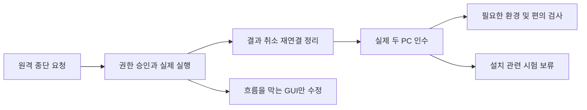

# Native Client·Agent 미구현 및 추가 검증 작업 계획

> **Document ID**: `DOC-PLAN-NATIVE-COMPLETION`\
> **Status**: Superseded · **Target Version**: v0.1.26 당시 통합 계획 기준\
> **Last Updated**: 2026-10-12 · **Classification**: Implementation & Test Plan

## 개요

> [!IMPORTANT]
> 사용자가 `client-native` GUI를 재구성할 예정이므로 현재 작업에서 제외하고 Agent 서비스 계획을 별도로 요청했다. 현재 Agent 서비스의 작업·시험·종료 기준은 [Agent 서비스 구현 및 검증 계획](agent-service-implementation-and-test-plan.md)이 대체한다. 이 문서의 GUI/IME/UIA와 통합 작업 목록은 이전 범위의 참조이며 현재 실행 지시나 필수 선행 작업이 아니다.

현재 Rust/Slint Client와 Rust Agent의 후속 작업을 **원격 요청→Gateway→Agent→실제 작업→결과 반환**의 관점으로 정리한다. 연결·실행·권한·요청별 승인·작업 추적·취소·재연결·자원 정리가 최우선이다. GUI는 등록·권한 설정·승인이 이 흐름을 막는 경우에 우선 수정하고, 로컬 입력기의 후보/조합과 화면 편의 시험은 후순위로 둔다. OS별 전용 API 확장과 이미 동작하는 구성의 재구현을 핵심 인수의 선행 조건으로 추가하지 않는다.

이 문서는 후속 작업의 우선순위와 완료 조건을 관리한다. 아키텍처와 전환 범위는 [Rust 전환 계획](rust-client-migration-plan.md), 실행 결과·실패·정확한 artifact hash는 [구현 현황](../quality/implementation-status.md)이 각각 SSOT다. 체크박스는 계획 상태이며 테스트 합격 증거가 아니다.

> [!IMPORTANT]
> 이번 요청은 **계획서 작성**이다. 이 문서만으로 구현·테스트·설치·삭제·배포를 시작하지 않는다. 최신 사용자 지시인 **실제 설치 금지**를 유지한다. Installer EXE 생성과 정적 검사는 가능하지만 설치 EXE 실행·설치/제거 시험·서비스 등록은 별도 명시적 요청 전 보류한다. 기존 등록 정보·사용자 데이터·서비스를 변경하지 않는다.

## 목차

- [1. 기준선과 상태 판정](#section-01)
- [2. 실행 순서와 우선순위](#section-02)
- [3. 결함 수정 및 구현 작업](#section-03)
- [4. 추가 테스트 계획](#section-04)
- [5. 미연결 확장 기능](#section-05)
- [6. 실행·증거·종료 규칙](#section-06)
- [7. 첫 작업 묶음과 완료 기준](#section-07)
- [8. 관련 문서](#section-08)

## 1. 기준선과 상태 판정

| 영역 | 현재 상태 | 후속 작업의 의미 |
|---|---|---|
| Client GUI | Rust + Slint([ADR-0032](../adr/ADR-0032-native-client.md)), 앱 내부 UI 모델·트레이·등록·권한·승인 화면 존재 | 원격 등록·권한 저장·승인을 막는 결함부터 수정. 일반 입력/화면 편의는 후순위 |
| Agent | Rust, 등록·WSS·인증된 로컬 IPC·파일·프로세스·터미널·권한·승인·작업 취소의 실행 증거 존재 | 동일 기능을 다시 만들지 않고 실패·재연결·복구·부하 조건을 확대 검증 |
| 사용자 설치본 | v0.1.26 setup 생성, 지시 이전의 임시 설치·GUI·제거 증거 존재 | 새 설치 실행은 금지. 현재 산출물의 정적 검증과 재현 가능한 빌드 정의 유지 |
| 단일 portable/ZIP | 완성된 artifact 및 정적 무결성 증거 존재 | packaging stub과 구분. 실제 portable 실행은 아직 별도 검증 필요 |
| Gateway / Console | Python 서버와 TypeScript 웹 앱 유지, 현재 개발 빌드·서버 응답 증거 존재 | Client 변경과의 계약 회귀를 확인. 최신 설치본이 전체 시스템 인수를 대신하지 않음 |
| 선택 runtime | 브라우저·분석 host·일부 OS Provider 코드 존재 | runtime 필요/권한 부족/미지원 상태와 미구현을 구별하여 필요한 기능만 실제 연동 확인 |
| OS 확장 | 현재 권한 catalog의 `implementation=planned` 항목 존재 | 공개 계약과 Provider 연결이 남은 기능. 핵심 종료 조건에서 제외 |
| 레거시 산출물 정리 | 과거 `dist` 삭제는 실행 정책에 차단된 기록 존재 | 정리 미완료를 기록하되 새 빌드/GUI 기능의 재구현 이유로 사용하지 않음 |

상태 표기는 다음 기준을 사용한다.

- **확인된 결함**: 실제 실행에서 실패하거나 상태가 어긋난 증거가 있다. 재현 후 수정한다.
- **미구현·미연결**: 필요한 사용자 흐름 또는 공개 RPC/권한/Provider 연결이 없다. helper 파일 존재만으로 완료로 판단하지 않는다.
- **구현됨·검증 필요**: 코드 경로는 있지만 해당 환경·실패 조건의 실제 증거가 부족하다. 테스트부터 진행한다.
- **보류**: 현재 사용자 범위 밖이거나 필요한 PC/runtime/별도 실행 요청이 없다. 완료로 표시하지 않는다.

> [!NOTE]
> `CAPABILITY_UNAVAILABLE`, 관리자 권한 부족, 선택 runtime 미설치, 다른 OS의 `NOT_SUPPORTED`는 곧바로 미구현 결함을 뜻하지 않는다. 현재 [권한 catalog](../../packages/protocol/src/racp_protocol/permission_catalog.json)와 실제 dispatch를 대조한다. [migration inventory](../../crates/racp-contract/migration-inventory.json)의 과거 baseline 목록을 현재 미구현 목록으로 그대로 복사하지 않는다.

## 2. 실행 순서와 우선순위

| 우선순위 | 작업 범위 | 다음 단계로 넘어가는 조건 |
|---|---|---|
| P0 | 원격 종단 실행·권한/승인·취소·재연결·자원 정리, 실제 두 PC 경로 | 요청의 실제 효과·최종 결과·소유 자원 정리 증거 확보. 두 PC 환경이 없으면 해당 항목은 미검증으로 남김 |
| P1 | 원격 흐름을 막는 GUI 결함, 상태 표시·회귀 실행기, 설치 없는 빌드/계약/CI 검사, 단기 부하 | 원격 등록·권한 저장·승인과 실제 상태 표시가 정상이며 같은 artifact의 회귀를 재현 가능 |
| P2 | 로컬 GUI의 IME candidate/조합·focus/scroll 편의·Narrator/GPU, 장시간 부하, 필요한 선택 runtime | 재현된 사용자 문제나 제공 기능의 요구가 있을 때 검사. 원격 완료 조건의 선행 작업으로 강제하지 않음 |
| P3 | 자동 업데이트·부분 실패 복구, Gateway setup, 머신 서비스, OS별 전용 API, 타 OS | 해당 범위의 별도 요청과 선행 조건 확보 후 시작 |

기간을 먼저 확정하지 않는다. P0 재현 결과와 제공 가능한 테스트 환경을 확인한 뒤 작업별 예상 시간을 기록한다. 첫 묶음이 끝나면 사용자에게 결과와 잔여 항목을 보고하고 불필요한 기능 확장을 계속하지 않는다.

## 3. 결함 수정 및 구현 작업

아래 작업은 모두 미완료 계획 항목이다. 먼저 R01–R05로 실제 원격 동작을 검사하고 실패한 경로만 수정한다. 코드가 있다는 이유로 합격하지 않고, 테스트가 남았다는 이유로 기능을 새로 만들지도 않는다.

### 3.1 핵심 원격 제어 — 먼저 수행

| ID / 우선순위 | 확인할 문제 | 작업과 완료 조건 |
|---|---|---|
| R01 / P0 | 로컬 IPC나 health 응답 성공만으로 원격 제어 완료를 판단하는 문제 | 실제 호출자 MCP/API→Gateway→WSS Agent→작업→호출자 결과의 한 흐름을 검증. target Device·request/operation ID·최종 결과가 일치하고 잘못된 Device에 실행되지 않음 |
| R02 / P0 | 제공한다고 주장하는 핵심 기능의 실제 효과 | 허용 폴더의 파일 읽기/쓰기·artifact 전송, 명령 exit/stdout/stderr, 지속 터미널 입출력/resize/종료를 검사. 화면 관측·입력도 원격 대상의 테스트 창에서 실제 효과를 확인. 접수 응답만으로 작업 성공을 판정하지 않음 |
| R03 / P0 | 원격 변경 요청에 대한 권한과 현지 승인 | allow/deny/승인/거부/만료/재사용을 원격 요청에서 확인. GUI 승인 결과가 실제 실행에 반영되고 거부된 요청은 부작용 없음. workspace·executable·Device/session 경계를 유지 |
| R04 / P0 | 단절·재시작·결과 유실 이후의 작업 상태 | ACK/결과 유실, Gateway/Agent 재시작, 중복 요청, timeout/취소를 검사. 동일 변경 중복 실행 없음, 복구 불확실성은 UNKNOWN 보존, 성공/실패/cancel 최종 상태가 뒤집히지 않음 |
| R05 / P0 | 원격 요청 종료 뒤 남는 프로세스·터미널·입력 자원 | 자식 tree·터미널·Broker/Guardian·입력 lease 및 port를 추적. 취소·연결 끊김·사용자 입력 개입 때 소유 자원이 정리되고 타 프로세스/사용자 입력을 계속 제어하지 않음 |

실제 두 PC 환경이 제공되면 R01–R05를 해당 경로에서 우선 확인한다. 환경이 없을 때는 동일 PC의 독립 Gateway/WSS로 실패 조건을 검사할 수 있지만 실제 LAN/두 PC 인수로 기록하지 않는다.

### 3.2 원격 흐름 지원과 후순위 작업

| ID / 우선순위 | 현재 근거 | 작업과 완료 조건 |
|---|---|---|
| F01 / P1 | Agent가 ONLINE이 된 뒤에도 하단 시작 안내가 IPC 대기로 남음. [slint_ui.rs](../../apps/client-native/src/slint_ui.rs)의 요청 메시지와 snapshot 상태를 대조할 필요(Iced `app.rs`는 v0.1.34에서 삭제) | 시작/연결/실패/정지를 구분하고 실제 snapshot 수신 후 대기 안내 해제. 시작→ONLINE→정지→재시작에서 화면과 Agent 상태 일치 |
| F02 / P1 | 승인 결과가 끝나도 하단에 최종 결과 대기가 남는 실행 기록 | receipt와 최종 event의 연결·순서·재동기화를 확인. 허용/거부/만료/취소/실패 후 실제 최종 결과를 표시하고 완료된 요청을 대기로 남기지 않음 |
| F03 / P1 | 일부 UIA Invoke가 반영되지 않음. Iced 시절 `accessibility.rs`의 epoch 경로는 v0.1.34에서 삭제했고 Slint 내장 AccessKit으로 대체 | epoch 경합과 무반응의 인과관계를 먼저 재현. 폐기된 컨트롤을 오작동시키지 않으면서 현재 컨트롤의 클릭/키보드/UIA 동작을 일치시킴. queue 유실과 stale 요청을 구분 |
| F04 / P2 | UIA focus는 true인데 rectangle이 0이거나 다른 권한 영역으로 scroll 이동한 기록 | semantic ID, view 재생성, focus 대상과 scroll reveal을 대조. 대상 입력/버튼이 실제로 보이고 정확한 항목에 입력되며 권한 저장 후 위치가 예측 가능함 |
| F05 / P2 | 한국어 IME 조합·candidate 연동 경로가 미완성이고 실제 입력 검증 부족 | Slint/winit 입력 경계의 조합/commit/취소/caret 처리를 확인해 필요한 경로를 보강(Slint PoC에서 기본 조합·확정은 확인). 한글 실제 키 입력·조합 수정·후보 선택·포커스 변경이 중복/손실 없이 동작. 직접 Unicode 문자열 주입을 IME 합격으로 간주하지 않음 |
| F06 / P1 | Agent 단독/Client 동반 빌드의 feature 통합 범위와 hash가 다를 수 있음 | 역할별 payload와 SBOM·동반 Agent hash를 명시. 테스트를 실행한 EXE의 hash로만 결과를 연결하며 다른 output의 성공을 자동 이관하지 않음 |
| F07 / P1 | 현재 GUI 검증 probe는 있으나 흐름별 도구 조작에 의존. Computer Use helper 초기화 오류 기록 존재 | GUI 핵심 회귀를 재실행 가능한 절차/실행기로 정리. target PID·버전·state·payload를 명시하고 실제 UIA 및 Gateway/Agent 결과를 함께 판정. 실행기 오류를 제품 실패와 분리 |
| F08 / P1 | [Client CI](../../.github/workflows/client.yml)는 NSIS compiler를 재귀 탐색해 정확히 하나만 요구하지만 확보한 archive에는 두 compiler 경로가 존재. 다운로드 challenge 기록도 있음 | 사용할 compiler 경로를 명시하고 버전·archive hash를 검증. 신뢰한 mirror fallback과 실패 진단을 정리. Windows artifact 생성까지만 확인하며 CI에서 설치를 실행하지 않음 |
| F09 / P2 | 브라우저/분석 관련 Provider·선택 host 코드는 있으나 제공 범위의 실제 runtime 경로 확인 부족 | 먼저 필요한 도구/operation만 선택. 신뢰 manifest admission→요청→결과→종료를 해당 도구로 검증. runtime 없는 상태의 정직한 오류와 Agent 생존 확인 |
| F10 / P3 | 업데이트/복구 관련 일부 helper는 있지만 자동 업데이트의 완결된 사용자 흐름과 부분 실패 복구는 미완성·미검증 | native artifact 검증·중단된 전환·원본 보존·rollback/UNKNOWN 처리의 계약을 정리한 후 필요한 구현만 추가. 낮은 수준의 restore helper와 제품 자동 updater를 구분. 설치 금지 해제 전 실행 시험 보류 |
| F11 / P3 | Gateway setup이 참조하는 deployment manifest/NSIS recipe가 현재 checkout에 없음 | Gateway setup이 별도 요청될 때 Git 추적 가능한 recipe 경로와 pin을 확정하고 builder/test의 경로를 일치시킴. 현재 Portable Gateway를 다시 만들지 않음 |
| F12 / P3 | 머신 서비스·세션 Broker·provision/restore code가 있으나 자동 설치의 부분 실패와 실제 서비스 수명주기 인수 부족 | 요청된 machine 범위만 설치 identity·권한·복구·세션 분리 검증. 현재 사용자 설치본과 분리하며 기존 서비스에 시험하지 않음 |

F03의 epoch guard를 무조건 제거하거나 F05를 위해 GUI를 다른 기술로 전면 재작성하는 것을 기본 해법으로 삼지 않는다. 원인과 변경 범위를 확인한 뒤 가장 작은 수정으로 해결한다.

P1/P2의 GUI 문제가 실제 등록·권한 저장·승인을 막으면 R03의 P0 blocker로 처리한다. 해당 원격 흐름을 복구하는 최소 수정만 수행하고, IME 고급 시험이나 UI 전체 개선까지 묶어서 확장하지 않는다.

## 4. 추가 테스트 계획

### 4.1 설치를 실행하지 않는 검사

| ID | 대상 / 절차 | 합격 기준 |
|---|---|---|
| T01 | 현재 SSOT 버전, frozen lock, Rust format/check, Python Ruff/mypy, Console 생성 타입/production build, contract inventory 확인 | 요구 계약/버전이 일치하고 역할별 빌드가 통과. 미연결 권한을 실행 가능한 것으로 공개하지 않음 |
| T02 | staging manifest·EXE 해시/크기/PE target·SBOM·setup/portable/ZIP 구조 검사. setup EXE는 실행하지 않음 | admitted 파일만 포함, hash 일치, 잘못된 OS/arch·추가 runtime·credential/state 미포함. stub을 사용자 실행 파일로 배포하지 않음 |
| T03 | 기존 Agent 실행기로 임시 Gateway/state에서 등록·연결·파일·프로세스·터미널·권한·승인·취소·정지/재시작 확인 | 각 요청의 실제 결과와 정책이 일치하고 소유 자원이 정리됨. 테스트 state/Gateway만 사용 |
| T04 | staging GUI에서 새 등록→권한 저장→Agent 시작→허용/거부→작업 표시→정지/재시작→종료. F01–F04 수정 경로 포함 | GUI 표시와 실제 Gateway/Agent 결과 일치. UIA/키보드/마우스가 같은 의도를 실행하고 확인된 무반응·대기 문구 결함 미재현 |
| T05 | 원격 요청으로 한글·공백 파일 경로/명령 인자 전달, stdout/stderr·ConPTY 입출력·테스트 창의 desktop.type 결과 확인 | 요청한 경로/내용/인자가 대상 PC에서 정확히 처리되고 결과가 손실 없이 돌아옴. 로컬 GUI의 IME 후보/조합 시험과 구분 |
| T06 | ACK/결과 유실, Gateway/Agent 재시작, 네트워크 단절, 승인 만료·재사용, 중복 요청·충돌, 취소 직후 재연결 | 부작용 중복 실행 없음, terminal 결과 불변, 복구할 수 없는 상태는 UNKNOWN으로 남음. 소유하지 않은 프로세스에 영향 없음 |
| T07 | 임시 자원에서 workspace 경계·junction/링크·정책 축소·IPC actor/session 검증·출력 한도·디스크/스풀 압박 검사 | 권한과 경계를 우회하지 않음. 예산 초과·malformed 입력이 Agent를 죽이지 않으며 token/credential이 화면·로그·artifact에 노출되지 않음 |
| T08 | 연결 종료/취소/GUI 정상 종료·비정상 종료 시 소유 자식·터미널·브라우저·Broker·handle/lease 추적 | 정리 완료와 미확정 정리를 구분. 테스트가 소유한 잔여 프로세스/port/입력 lease 없음. 상주 등록용 자원은 별도로 식별 |

검사 순서는 T01/T02로 대상 artifact를 확정한 뒤 **T03·T05–T09의 원격 흐름을 우선**한다. T04는 실제 등록·권한·승인 경로만 확인한다. 기존 [Agent 실행기](../../scripts/test_native_agent.py)와 [GUI probe](../../scripts/probe_native_gui.py)를 활용하며 실패한 경로만 수정한다. 관련 검사 통과 후 이유 없이 전체 검사를 반복하지 않는다. 이번 계획 개정에서는 시험을 실행하지 않는다.

### 4.2 환경이 필요한 검사

| ID | 선행 조건 | 절차와 합격 기준 |
|---|---|---|
| T09 / P0 | 사용자가 지정한 두 Windows PC, 도달 가능한 Gateway, 테스트 계정/폴더 | R01–R05를 실제 LAN/WSS에서 확인. 같은 PC의 loopback 결과와 구분. 기존 등록/service를 바꾸거나 원격 PC를 재부팅하지 않음 |
| T10 | 원격 대상의 모니터 구성 및 테스트 창 | 원격 screenshot·관측 handle·클릭·입력 좌표가 100/150/200% DPI, 다중 모니터, 음수 좌표, 창 이동 뒤에도 실제 대상과 일치하는지 우선 확인. Client 자체의 화면 편의·Narrator·GPU는 P2로 분리 |
| T11 | 선택 runtime manifest와 실제 설치된 테스트 도구 | 선택한 browser/analysis operation과 종료·충돌·취소·출력 경계를 실제 도구에서 확인. tool crash 뒤 Agent 핵심 작업 생존. 사용자가 요청하지 않은 runtime을 추가 설치하지 않음 |
| T12 | 전용 테스트 시간·자원 예산 | 짧은 부하 확인 후 30분 부하와 8시간 soak를 계획. 시작 전에 CPU/RSS/handle/queue/spool 예산과 warm-up 구간을 고정. 지속 증가·누수·작업 유실·재연결 실패를 측정하고 기준을 사후 완화하지 않음 |

로컬 GUI의 IME candidate/commit·복잡한 조합 중 Backspace/방향키/포커스 이동은 F05/P2다. 기본 연결 파일·작업 폴더 입력이 실제 등록을 막을 때에만 해당 결함을 먼저 해결한다. 원격 입력/전송의 Unicode 보존은 T05로 별도 검사한다.

### 4.3 현재 실행하지 않는 설치·배포 검사

| ID | 보류 이유 | 허용 범위가 변경되면 확인할 내용 |
|---|---|---|
| T13 | 실제 설치 금지 | 전용 clean Windows 환경의 사용자 setup 설치·첫 실행·등록 state 보존·중복 설치·취소/디스크 부족·업그레이드/제거. 개발 PC의 과거 임시 시험과 구분 |
| T14 | installer/runtime 실행 정책 확인 필요 | 완성된 portable EXE의 extraction/실행/재실행/손상 거부·state 분리와 ZIP 실행. 현재는 정적 검증만 계획 |
| T15 | 머신 서비스 등록·OS 상태 변경은 별도 범위 | 전용 환경의 machine setup/service identity·로그아웃/재부팅·세션 Broker·부분 provision/restore·제거 보호 |
| T16 | 서명 자격 증명·배포 요청 없음 | Authenticode·신뢰 chain·timestamp 및 signed artifact 동일성 검증. 서명 key는 package/로그에 넣지 않으며 게시를 별도 판정 |
| T17 | macOS/Linux native 빌드 보류 | OS/arch별 native build/GUI/runtime/installer 인수. Windows 결과를 다른 OS에 이관하지 않음 |

> [!WARNING]
> 계획서에 T13–T17을 기재한 것은 실행 허가가 아니다. 현재 PC에서 setup/portable 실행·설치·제거·서비스 변경을 시작하지 않는다. 설치·배포 범위가 명시적으로 바뀐 뒤 지정된 전용 환경과 artifact로 확인한다.

## 5. 미연결 확장 기능

현재 [권한 catalog](../../packages/protocol/src/racp_protocol/permission_catalog.json)의 `implementation=planned`와 빈 operation 연결을 기준으로 다음 기능군을 후순위로 관리한다. 전체 목록·정확한 ID는 catalog에서 확인한다. 소스 helper가 있더라도 공개 기능의 연결과 인수가 없으면 완료로 표시하지 않는다.

| 기능군 | 현재 미연결 범위 | 구현에 앞서 필요한 결정 |
|---|---|---|
| 저장장치 | health/usage/mount/raw read·write/partition/format | 관측이 실제 필요한지 결정. 장치 변경은 핵심 원격 제어의 선행 조건으로 두지 않음 |
| 실행 확장 | recipe/script/elevated | 기존 shell/exec로 충족되는지 검토하고 고정 recipe·승격 범위를 먼저 확정 |
| 앱·클립보드 | 앱 inventory/launch/close, clipboard formats/files | 현재 process/desktop/clipboard API와 중복 여부, 사용자/session 경계 확인 |
| 네트워크 | probe, layer2/IPv6 capture, HTTP record, configuration/firewall modify | 실제 backend·runtime·권한·연결 단절 복구 범위 정의 |
| 메모리·분석 | memory write/allocate/protection, dump/trace export, debugger register/memory write | 관찰 기능과 변경 기능 분리, 정확한 process identity/offset·출력/취소 경계 정의 |
| 시스템 설정 | services control/configure, registry read/modify, tasks read/owned modify, software install/uninstall | 터미널 제어로 부족한 구체적 요구를 먼저 확인. 필요 기능만 typed 계약으로 추가하며 불필요한 object/API 분할을 강제하지 않음 |
| 계정·세션·전원 | accounts read/modify, lock/logoff/reboot/shutdown/sleep | 사용자 영향·현지 확인·실행 후 연결/자원 정리 범위 정의. 실제 상태 변경 시험은 별도 범위 |
| 진단 | OS trace recording | 지원 backend와 기간/filter/예산 정의. 이미 연결된 diagnostics/events query/performance API와 구분 |
| 백업·설정 | workspace backup/restore, remote-facing agent settings read/local modify drafts | 기존 GUI 로컬 설정 저장과 다른 공개 계약인지 먼저 확인. 소유 범위·consistency·복원 계획 확정 |

서비스·레지스트리·작업 스케줄러를 모두 구현해야 제품이 SSH와 달라지는 것은 아니다. RACP의 핵심 종료 기준은 요청에 대한 권한·승인·취소·결과 추적과 원격 자원 정리가 동작하는 것이다. 확장에는 구체적 사용 요구가 있어야 한다.

## 6. 실행·증거·종료 규칙

1. 작업 시작 시 기준 source/dirty 상태·lock·대상 artifact·선택 시나리오를 확정한다. 구현 완료와 검사 통과를 따로 기록한다.
2. 실패를 제품 결함, 테스트 실행기 결함, 환경 부족, 미지원/정책 거부로 구분한다. 기존 수치를 복사하거나 보류를 PASS로 바꾸지 않는다.
3. code 변경 배치의 버전은 [AGENTS](../../AGENTS.md)에 따라 관리하고 재시도/형식별로 증가시키지 않는다. 이 문서 작성만으로 v0.1.26 제품을 다시 빌드하거나 새 릴리스를 생성하지 않는다.
4. Client·Agent·Gateway·Console의 출력은 [빌드 경로 규칙](../../AGENTS.md#9-build-output-layout)을 따른다. raw 결과는 `dist/verification/<component>/<version>/<run-id>/`, 누적 판정은 [구현 현황](../quality/implementation-status.md)에 기록한다.
5. 증거에는 artifact hash·시나리오·환경·기대/실제 결과·실패 이유·소유 자원 정리 여부를 포함한다. 등록 token·credential·비밀 값은 기록하지 않는다.
6. 제품 GUI에는 미구현/검증 필요/계획 번호를 추가하지 않는다. 사용자에게 필요한 연결 상태·사용 조건·오류와 조치만 표시한다.
7. 설치 금지, 기존 사용자 state/service 보존, Windows 기본 실행 범위를 유지한다. 설치 정책 변경과 누락된 원격 테스트 환경은 실제 진행 시 확인한다.
8. 추가 agent/thread, OS API 확장, 원격 설치·서비스 변경을 계획서만 보고 자동으로 시작하지 않는다.

## 7. 첫 작업 묶음과 완료 기준

- [ ] T01/T02: 설치 실행 없이 테스트할 artifact와 핵심 계약을 확정한다.
- [ ] R01/R02 및 T03/T05: 원격 요청의 실제 파일·명령·터미널·화면/입력 효과와 반환 결과를 확인한다.
- [ ] R03 및 T04/T07: 원격 권한·승인·거부를 확인하고 이를 막는 GUI 결함만 우선 수정한다.
- [ ] R04/R05 및 T06/T08: 취소·재연결·중복 실행 방지·작업 상태·자원 정리를 확인한다.
- [ ] T09: 실제 두 PC 경로의 결과를 확보하거나 환경 부족을 명확히 기록한다.
- [ ] F06/F07: 같은 artifact로 해당 원격 회귀를 재현할 수 있게 증거와 실행 절차를 연결한다.
- [ ] 결과와 남은 blocker를 구현 현황에 기록하고 다음 묶음의 범위를 보고한다.

이 묶음의 종료 조건은 **호출자에서 대상 Agent까지 원격 실행·권한·승인·취소·결과 추적·재연결·자원 정리가 실제로 보장되는 증거 확보**다. 두 PC 환경이 없으면 핵심 로컬 격리 검증과 실제 원격 인수를 구분해 보고한다. IME 고급 시험·UI 편의, OS 확장 전체, machine service, 자동 업데이트, 타 OS, 서명·게시를 이 묶음에 추가하지 않는다. 설치형 파일은 이미 존재하므로 재구현하지 않으며 설치 금지를 유지한다. 설치 관련 보류가 남아 있으면 정식 배포 인수 완료로 표현하지 않는다.

## 8. 관련 문서

- [Rust 전체 전환 설계·마스터 계획](rust-client-migration-plan.md)
- [구현 및 실제 검증 현황 — 결과 SSOT](../quality/implementation-status.md)
- [Windows 세부 시험·두 PC 계획](windows-engineering-plan.md)
- [Windows 배포 인수 게이트](../quality/windows-release-gates.md)
- [Desktop Client 설치·운용 가이드](../guides/desktop-client-guide.md)
- [권한·OS 기능 아키텍처](agent-permissions-and-capabilities.md)
- [저장소 실행·빌드 규칙](../../AGENTS.md)
- [명세서 목록](README.md)
